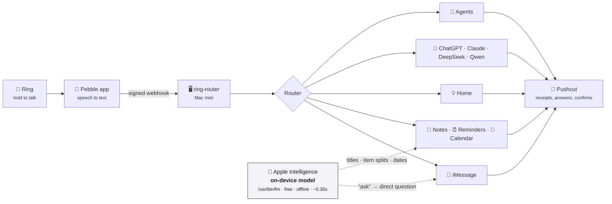

<div align="center">

# 💍 ring-router

**Say it to your ring. The Mac mini does it.**

A voice-command router for the [Pebble Index 01](https://repebble.com/index) smart ring.
Hold the button, speak, and your words become an iMessage, a note, a reminder, a calendar event,
a light switch, or a question to the AI model of your choice.


-yellow)

[How it works](#how-it-works) · [What you can say](#what-you-can-say) · [Quick start](#quick-start) ·
[Testing](#testing-without-a-ring) · [Status](#status) · [**Build plan →**](docs/PLAN.md)

</div>

---

## How it works



1. **The Pebble app** transcribes your recording and POSTs it, HMAC-signed, to one webhook.
2. **ring-router** verifies the request (secret path, signature, timestamp, de-duplication).
3. **The router** checks, in order: a cancel phrase → an exact scene → a fixed prefix → a refusal →
   the general agent. Fixed prefixes never touch a cloud LLM.
4. **The handler** acts, and **Pushcut** tells you what happened. It only asks first when a
   recipient name is a near-miss, or for actions you've chosen to confirm.

> **Push-to-talk means intent.** The ring only listens while you hold the button, so what you say
> runs, including "unlock the front door" and "open the garage". Confirmations are opt-in per
> action (`[home] confirm_actions`). The one built-in check is about *who*, not *what*: messages
> only go to allowlisted recipients.

Apple's **on-device model** (`/usr/bin/fm`) handles the small language jobs for free and offline:
turning *"ask Terri when she'll be home"* into *"When will you be home?"*, titling notes, splitting
shopping lists, and reading dates out of reminders and events.

---

## What you can say

| You say | What happens |
| --- | --- |
| *"Tell Terri I'm on my way."* | 💬 iMessages Terri: **"I'm on my way."** |
| *"Ask Terri when she'll be home."* | 💬 Rewritten on-device: **"When will you be home?"** |
| *"Hey Terri, dinner's ready"* | 💬 Sent as spoken: **"Dinner's ready"** |
| *"Tell the guys let's hang out tomorrow."* | 💬 Posts to the group chat |
| *"Make a note: the boat trailer needs new bearings"* | 📝 New note titled **"Boat Trailer Bearings Replacement"** |
| *"Remember I parked on level 3, row G"* | 📝 Saved to the **Remember** folder |
| *"Add milk, eggs and mac and cheese to my shopping list"* | 🛒 Three reminders: Milk · Eggs · Mac and cheese |
| *"Remind me tomorrow at 5pm to call the vet"* | ⏰ Reminder due tomorrow 17:00 |
| *"Add ring-router test event tomorrow at 3pm to my calendar"* | 📅 One-hour event on your default calendar |
| *"Add dentist Tuesday at 3 to my calendar"* | 📅 Event on Tuesday at 15:00 |
| *"Add date night Friday at 7 to our calendar"* | 📅 Goes on the shared calendar (spoken names map to calendars in config) |
| *"Turn off the living room lights"* | 💡 Every light in that room, via Hubitat |
| *"Set the master bedroom fan to low"* / *"Dim the sconces to 20%"* | 🌀 Fan speed and dimmer levels |
| *"Turn on the living room fan"* | 🌀 "Fan" means the ceiling fan when several match; otherwise it asks "Which one?" |
| *"Lock the garage patio door"* | 🔒 Locks run as spoken (confirm-first is opt-in) |
| *"Unlock the front door"* / *"Open the front garage door"* | 🏠 HomeKit-native devices via HomeMCPBridge |
| *"Remind me when I get home to take out the trash"* | 📍 Geofenced reminder at the address on your Contacts card |
| *"Ask DeepSeek what's the best Chinese restaurant near me"* | 🤖 Web-backed answer as a notification, full text + sources a tap away |
| *"Ask DeepSeek more about that"* | 🤖 Continues the same conversation (within 10 minutes) |
| *"Research the best robot vacuum under $500"* | 🔎 A research note in Apple Notes |
| *"Ask Claude Code on the RackNerd VPS why the websites are down"* | 🛠️ Claude Code investigates on that host |
| *"What's on my calendar Thursday?"* | 🧠 General agent reads your calendar |
| *"What's the best Chinese restaurant in Charleston?"* → *"Which of those is cheapest?"* | 🧠 General agent searches the web; follow-ups keep the thread |
| *"Can you add dinner at the cheapest one Friday at 7 to my calendar?"* | 🧠 Same agent, same thread: question-shaped requests just work |
| *"Make a new contact named John Smith, 555-1212"* | 👤 General agent creates the contact |
| *"Okay Mark, thanks, see you later… ask DeepSeek what color is the sky"* | 🧹 Agent spots the buried command and hands it to DeepSeek |
| *"Tell Terri I'll be late. Scrap that."* | 🚫 **Cancelled**, nothing sent |
| *"Tell Harry I'm on my way"* | 🚫 Not on the allowlist, nothing sent |
| *"Set a timer for 10 minutes"* | 🚫 Refused (timers aren't supported) |

<details>
<summary><b>Safety rules</b></summary>

- **Allowlist only.** Messages go only to people and chats in your config. Close-but-not-exact names
  ("Sherry" for Terri) need a **Send / Cancel** tap; unknown names are refused.
- **No guessing at numbers.** A recipient's number is the `handle` in your config, or the one Contacts
  card with that exact name. No card, or two of them, and nothing is sent.
- **"Tell" is verbatim.** Only "ask X…" is rewritten, and the receipt always shows the exact text sent.
- **Optional confirm-first actions.** List any home actions (e.g. `unlock`, `open`) in
  `[home] confirm_actions` to require a Pushcut tap. Empty by default: the ring only listens while
  you hold the button, so what you say runs.
- **Cancel by voice.** End any command with "scrap that", "never mind", "cancel cancel"…
- **No double texts.** A send that times out is marked unknown and never retried automatically. The
  fixed routes give each mcp-macos or HomeKit call 60 seconds, so a stuck permission prompt can't hang
  a command.
- **Old recordings ask first.** A message or home command that arrives more than 5 minutes after you
  said it (`[server] max_recording_age_s`) gets a **Run / Cancel** tap instead of running. "Remind me
  in 20 minutes" counts from when you spoke.
- **Noise-tolerant, not inventive.** When background talk hides a command, the agent can hand it back to
  the router, but only as a word-for-word excerpt of what you said. "Don't unlock the door" is not
  handed back, and a rerouted message, unlock or garage-open asks first.
- **The agent can't text or email.** It gets calendar, reminders, notes, contacts and web search; allowed
  tools *and actions* are enforced in code, not just the prompt.
- **The agent only changes things you asked to change.** It may update or delete only when your own
  words call for it ("move", "cancel", "mark it done"…), so nothing it reads in an invite or on a web
  page can make it. One delete per request (`[agents] max_deletes`).
- **Dry run by default**, globally and per route, plus `live_recipients` to limit real sends while testing.

</details>

---

## Quick start

> **Requires** macOS 27 (for `/usr/bin/fm`), Python 3.11+, and
> [mcp-macos](https://github.com/krmj22/macos-mcp) (run via `npx`) for the Apple apps.

```sh
git clone https://github.com/DaveLinger/ring-router.git && cd ring-router
python3 -m venv .venv && .venv/bin/pip install -e '.[dev]'

cp config.example.toml config.toml   # recipients, models, hosts, lists... (git-ignored)
.venv/bin/ring-router init           # generates the path token + signing secret into .env
```

### Run it as a service

```sh
app/build.sh                         # builds build/Ring Router.app (see below)
helpers/georeminder/build.sh         # builds build/georeminder (location reminders)
cp launchd/local.ring-router.plist launchd/local.ring-router.watchdog.plist ~/Library/LaunchAgents/
launchctl bootstrap gui/$(id -u) ~/Library/LaunchAgents/local.ring-router.plist           # listener: now and at login
launchctl bootstrap gui/$(id -u) ~/Library/LaunchAgents/local.ring-router.watchdog.plist  # down alert every 5 min
launchctl kickstart -k gui/$(id -u)/local.ring-router                                     # restart after changes
tailscale funnel --bg 8642                                                                 # public HTTPS address
```

Set `[server] public_url` to the Funnel address so notification buttons, answer pages and the
activity page work from your phone. Logs: `~/Library/Logs/ring-router.log` (and `-watchdog.log`).

<details>
<summary><b>Why "Ring Router.app", and granting macOS permissions</b></summary>

macOS grants privacy permissions (Local Network, Calendars, Reminders, Contacts, Automation) to the
*responsible app*. A Homebrew Python started by launchd has no app identity, so macOS Local Network
privacy silently blocks it ("No route to host" to the Hubitat hub). `app/` builds a tiny signed
launcher bundle, **Ring Router.app** (`local.ring-router`), that starts the listener as a child and
stays its parent. Every permission then lives under one "Ring Router" entry in System Settings, and
survives Homebrew Python upgrades.

To trigger and verify all prompts from that same context:
`launchctl bootstrap gui/$(id -u) launchd/local.ring-router.permcheck.plist` runs
`ring-router check-permissions` (log: `~/Library/Logs/ring-router-permcheck.log`). Calendars needs
**Full Access**, not "Add Events Only".

mcp-macos is vendored in `vendor/`: npm now blocks the install script that compiles its EventKit
helper, and ring-router patches that helper (`vendor/patches/`) so `[calendars] sources = ["iCloud"]`
hides other accounts, such as a Google account that calsync mirrors into iCloud, which would otherwise
make every event appear twice. Set up with `vendor/setup.sh` (install, patch, build).
</details>

### Activity page and down alert

- **`/activity/<activity_token>`** (token in `.env`): recent commands with outcome and model cost.
  Tap one for its **step-by-step trace**: request metadata, exact transcript, cleaned text, route
  decision, on-device model input → output, composed message, model request and reply, every agent
  tool call with its result, device matches, each command sent to macOS/Hubitat with its result,
  notifications, and the HTTP response the Pebble app saw. Kept 90 days (`retention_days`).
- **Watchdog** (`ring-router watchdog`, every 5 minutes via launchd): checks the listener locally
  and through the tunnel; Pushcut alert after two failed checks ("listener down" vs "tunnel down")
  and once on recovery. It runs on the same Mac, so it can't report the Mac itself being off.

### Configuration

| File | What's in it | In git? |
| --- | --- | --- |
| `config.toml` | Recipients, models, hosts, lists, calendars, scenes, cancel phrases, dry-run flags | ❌ (copy from `config.example.toml`) |
| `.env` | `RING_ROUTER_PATH_TOKEN`, `RING_ROUTER_SIGNING_SECRET`, API keys (mode 600) | ❌ (see `.env.example`) |
| `prompts.toml` | **Every instruction given to a model**, marked LIVE or DRAFT | ✅ |
| `profile.md` | Facts about you added to every model prompt (location for "near me", etc.) | ❌ (see `profile.example.md`) |
| `tests/phrases.toml` | The answer key: phrases and how they must route and what they send | ✅ |

Add optional keys with `ring-router set-secret openrouter_api_key` (or `pushcut_webhook_url`,
`hubitat_token`), or edit `.env` directly. For Pushcut, the notification's Webhook URL is enough; no API key needed.

### Commands

| Command | Does |
| --- | --- |
| `ring-router serve` | Run the listener |
| `ring-router route "phrase"` | Route a phrase offline and show what would happen |
| `ring-router sim "phrase" …` | Send phrases to the running listener exactly as the ring would |
| `ring-router sim --file tests/phrases.toml` | Send the whole phrase list |
| `ring-router recent` | Show recent deliveries |
| `ring-router check-permissions` | Touch each macOS app and Hubitat once (run via the permcheck launchd job) |
| `ring-router watchdog` | One health check; Pushcut alert on change |
| `ring-router init` | Generate the path token, signing secret and activity token in `.env` |

---

## Testing without a ring

`ring-router sim` builds the same signed multipart request the Pebble app sends (headers,
HMAC-SHA256 signature, optional fake audio), so the whole pipeline runs end to end:

```console
$ ring-router sim "Ask Terri when she'll be home." "Tell Sherry I'm on my way"
▶ Ask Terri when she'll be home.
  ← 200 dry_run: [imessage] DRY RUN: would send to Terri (rewritten): 'When will you be home?'
▶ Tell Sherry I'm on my way
  ← 200 needs_confirm: [imessage] weak match 'sherry' -> Terri; confirmation Cf6-iuBYDYrgXUpe
```

Flags: `--test-event`, `--replay` (dedupe check), `--bad-signature`, `--audio`, `--trigger double-click-hold`.

```sh
.venv/bin/pytest -q               # everything (212 tests)
.venv/bin/pytest -m "not live"    # skip the tests that call the real on-device model
.venv/bin/pytest -m live          # only those: checks the exact text each message sends
```

[`tests/phrases.toml`](tests/phrases.toml) is the answer key. Each case lists the phrase, the
route, the text extracted after the prefix, and for messages the exact text that goes out. Add
phrases as you think of them; the tests fail until the router agrees.

---

## Status

| Piece | State |
| --- | --- |
| Webhook checks: secret path, HMAC v1, ±5 min, dedupe, test events | ✅ Done |
| Router: cancels, scenes, prefixes, recipient tiers, timer refusal | ✅ Done |
| On-device rewrites, note titles, item splitting, date extraction | ✅ Done (real model) |
| Ring simulator, phrase answer key, 212 tests | ✅ Done |
| iMessage / Notes / Reminders / Calendar / Contacts via mcp-macos | ✅ Live: text, note, shopping item, reminder and event created end to end through the tunnel |
| Pushcut notifications and buttons | ✅ Delivered; Send/Cancel and Full answer verified through the tunnel |
| Ask a model: OpenRouter, web search, follow-ups, `profile.md`, answer page | ✅ Live-tested with all four models |
| Research notes (web search → Apple Note) | ✅ Research live-tested; saving the note waits on the Notes permission |
| General agent (Pydantic AI): macOS tools, web search, follow-ups, `run_command` | ✅ Live: read the real calendar, then moved an event as a follow-up |
| Home control via Hubitat Maker API (optional module: lights, dimmers, fan speeds, locks) | ✅ Live; `[hubitat] enabled` (off by default, HomeKit then handles everything) |
| HomeKit-only devices (front door lock, garage doors, fireplaces, outlets…) | ✅ Live via a patched HomeMCPBridge, limited to one HomeKit home |
| Location reminders ("when I get home / when I leave") | ✅ Live: geofence from your Contacts card, verified on the iPhone |
| Activity page with per-command trace; watchdog down alert | ✅ Live |
| Ring Router.app (one macOS identity for all permissions) | ✅ Running the listener; all permissions verified |
| Claude Code per host | ⬜ Stub; needs SSH to the VPS |
| Tailscale Funnel tunnel, launchd service | ✅ Running; buttons and answer pages work from the phone |

See the **[build plan](docs/PLAN.md)** for the full design, decisions, and phase-by-phase roadmap.

---

## Project layout

```text
ring-router/
├── src/ringrouter/
│   ├── server.py      # HTTP listener, status codes, background jobs, confirmations
│   ├── protocol.py    # Pebble webhook v1: verify, parse, and build (for the simulator)
│   ├── router.py      # transcript → Route (pure function of text + config)
│   ├── recipients.py  # allowlist matching: strong / weak / unknown
│   ├── cancel.py      # trailing cancel-phrase detection
│   ├── handlers.py    # one handler per route; dry run enforced here
│   ├── fm.py          # Apple on-device model wrapper (greedy)
│   ├── llm.py         # OpenRouter client, follow-up memory, answer store
│   ├── agents.py      # the general agent (Pydantic AI, web search, tool/action guard)
│   ├── hubitat.py     # Hubitat Maker API: devices, spoken-name matching, commands
│   ├── activity.py    # activity page + per-command trace view
│   ├── watchdog.py    # down alert
│   ├── md.py          # Markdown → HTML for the answer page and research notes
│   ├── mcp.py         # minimal stdio MCP client for mcp-macos
│   ├── notify.py      # console + Pushcut notifiers
│   ├── store.py       # SQLite: deliveries, trace, pending confirmations
│   ├── prompts.py     # loads prompts.toml
│   ├── config.py      # config.toml + .env
│   └── cli.py         # ring-router command
├── app/               # Ring Router.app launcher (Swift) + Info.plist + build.sh
├── helpers/georeminder/  # Swift: geocode + EventKit location reminder
├── launchd/           # service, watchdog and permission-check jobs
├── vendor/            # pinned mcp-macos + HomeMCPBridge build script and patches (sources git-ignored)
├── tests/             # phrases.toml answer key + protocol, server, agent, hubitat, live-model tests
├── docs/PLAN.md       # build plan and decisions
├── prompts.toml       # all model instructions
├── config.example.toml
└── .env.example
```
