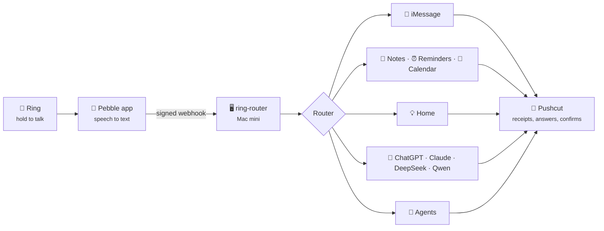

<div align="center">

# 💍 ring-router

**Say it to your ring. The Mac mini does it.**

A voice-command router for the [Pebble Index 01](https://repebble.com/index) smart ring.
Hold the button, speak, and your words become an iMessage, a note, a reminder, a calendar event,
a light switch, or a question to the AI model of your choice.


[How it works](#how-it-works) · [What you can say](#what-you-can-say) · [Quick start](#quick-start) ·
[Testing](#testing-without-a-ring) · [Status](#status) · [**Build plan →**](docs/PLAN.md)

</div>

---

## How it works



1. **The Pebble app** transcribes your recording and POSTs it, HMAC-signed, to one webhook.
2. **ring-router** verifies the request (secret path, signature, timestamp, de-duplication).
3. **The router** checks, in order: a cancel phrase → an exact scene → a fixed prefix → a refusal →
   a question → the general agent. Fixed prefixes never touch a cloud LLM.
4. **The handler** acts, and **Pushcut** tells you what happened, or asks before anything risky.

Apple's **on-device model** (`/usr/bin/fm`) handles the small language jobs for free and offline:
turning *"ask Terri when she'll be home"* into *"When will you be home?"*, titling notes, splitting
shopping lists, and reading dates out of reminders and events.

---

## What you can say

| You say | What happens |
| --- | --- |
| *"Tell Terri I'm on my way."* | 💬 iMessages Terri: **"I'm on my way."** |
| *"Ask Terri when she'll be home."* | 💬 Rewritten on-device: **"When will you be home?"** |
| *"Tell the guys let's hang out tomorrow."* | 💬 Posts to the group chat |
| *"Make a note: the boat trailer needs new bearings"* | 📝 New note titled **"Boat Trailer Bearings Replacement"** |
| *"Remember I parked on level 3, row G"* | 📝 Saved to the **Remember** folder |
| *"Add milk, eggs and mac and cheese to my shopping list"* | 🛒 Three reminders: Milk · Eggs · Mac and cheese |
| *"Remind me tomorrow at 5pm to call the vet"* | ⏰ Reminder due tomorrow 17:00 |
| *"Add dentist Tuesday at 3 to my calendar"* | 📅 Event on Tuesday at 15:00 |
| *"Turn on the living room light"* | 💡 Hubitat or HomeKit |
| *"Unlock the front door"* | 🔐 **Asks you first** in Pushcut |
| *"Ask DeepSeek what's the best Chinese restaurant near me"* | 🤖 Answer arrives as a notification |
| *"Research the best robot vacuum under $500"* | 🔎 A research note in Apple Notes |
| *"Ask Claude Code on the RackNerd VPS why the websites are down"* | 🛠️ Claude Code investigates on that host |
| *"What's on my calendar Thursday?"* | 🧠 Read-only questions agent |
| *"Tell Terri I'll be late. Scrap that."* | 🚫 **Cancelled**, nothing sent |
| *"Tell Harry I'm on my way"* | 🚫 Not on the allowlist, nothing sent |
| *"Set a timer for 10 minutes"* | 🚫 Refused (timers aren't supported) |

<details>
<summary><b>Safety rules</b></summary>

- **Allowlist only.** Messages go only to people and chats in your config. Close-but-not-exact names
  ("Sherry" for Terri) need a **Send / Cancel** tap; unknown names are refused.
- **"Tell" is verbatim.** Only "ask X…" is rewritten, and the receipt always shows the exact text sent.
- **Unlock and garage-open always ask first.** Scenes can never include them.
- **Cancel by voice.** End any command with "scrap that", "never mind", "cancel cancel"…
- **No double texts.** A send that times out is marked unknown and never retried automatically.
- **Dry run by default**, globally and per route, plus `live_recipients` to limit real sends while testing.

</details>

---

## Quick start

> **Requires** macOS 27 (for `/usr/bin/fm`), Python 3.11+, and
> [mcp-macos](https://github.com/krmj22/macos-mcp) (run via `npx`) for the Apple apps.

```sh
git clone https://github.com/DaveLinger/ring-router.git && cd ring-router
python3 -m venv .venv && .venv/bin/pip install -e '.[dev]'

cp config.example.toml config.toml   # recipients, models, hosts, lists... (git-ignored)
.venv/bin/ring-router init           # generates the path token + signing secret into .env
```

### Configuration

| File | What's in it | In git? |
| --- | --- | --- |
| `config.toml` | Recipients, models, hosts, lists, calendars, scenes, cancel phrases, dry-run flags | ❌ (copy from `config.example.toml`) |
| `.env` | `RING_ROUTER_PATH_TOKEN`, `RING_ROUTER_SIGNING_SECRET`, API keys (mode 600) | ❌ (see `.env.example`) |
| `prompts.toml` | **Every instruction given to a model**, marked LIVE or DRAFT | ✅ |
| `tests/phrases.toml` | The answer key: phrases and how they must route and what they send | ✅ |

Add optional keys with `ring-router set-secret openrouter_api_key` (or `pushcut_api_key`,
`hubitat_token`), or edit `.env` directly.

### Commands

| Command | Does |
| --- | --- |
| `ring-router serve` | Run the listener |
| `ring-router route "phrase"` | Route a phrase offline and show what would happen |
| `ring-router sim "phrase" …` | Send phrases to the running listener exactly as the ring would |
| `ring-router sim --file tests/phrases.toml` | Send the whole phrase list |
| `ring-router recent` | Show recent deliveries |

---

## Testing without a ring

`ring-router sim` builds the same signed multipart request the Pebble app sends (headers,
HMAC-SHA256 signature, optional fake audio), so the whole pipeline runs end to end:

```console
$ ring-router sim "Ask Terri when she'll be home." "Tell Sherry I'm on my way"
▶ Ask Terri when she'll be home.
  ← 200 dry_run: [imessage] DRY RUN: would send to Terri (rewritten): 'When will you be home?'
▶ Tell Sherry I'm on my way
  ← 200 needs_confirm: [imessage] weak match 'sherry' -> Terri; confirmation Cf6-iuBYDYrgXUpe
```

Flags: `--test-event`, `--replay` (dedupe check), `--bad-signature`, `--audio`, `--trigger double-click-hold`.

```sh
.venv/bin/pytest -q               # everything (114 tests)
.venv/bin/pytest -m "not live"    # skip the tests that call the real on-device model
.venv/bin/pytest -m live          # only those: checks the exact text each message sends
```

[`tests/phrases.toml`](tests/phrases.toml) is the answer key. Each case lists the phrase, the
route, the text extracted after the prefix, and for messages the exact text that goes out. Add
phrases as you think of them; the tests fail until the router agrees.

---

## Status

| Piece | State |
| --- | --- |
| Webhook checks: secret path, HMAC v1, ±5 min, dedupe, test events | ✅ Done |
| Router: cancels, scenes, prefixes, recipient tiers, timer refusal | ✅ Done |
| On-device rewrites, note titles, item splitting, date extraction | ✅ Done (real model) |
| Ring simulator, phrase answer key, 114 tests | ✅ Done |
| iMessage / Notes / Reminders / Calendar via mcp-macos | 🟡 Written; first live send waiting on a macOS permission prompt |
| Pushcut notifications and confirm buttons | 🟡 Written, untested (console notifier by default) |
| OpenRouter "ask a model" | 🟡 Written; needs an API key and model IDs |
| Home, research, questions agent, general agent, Claude Code per host, location reminders | ⬜ Stubs that report what they'd do |
| Tailscale Funnel tunnel, launchd service | ⬜ Not started |

See the **[build plan](docs/PLAN.md)** for the full design, decisions, and phase-by-phase roadmap.

---

## Project layout

```text
ring-router/
├── src/ringrouter/
│   ├── server.py      # HTTP listener, status codes, background jobs, confirmations
│   ├── protocol.py    # Pebble webhook v1: verify, parse, and build (for the simulator)
│   ├── router.py      # transcript → Route (pure function of text + config)
│   ├── recipients.py  # allowlist matching: strong / weak / unknown
│   ├── cancel.py      # trailing cancel-phrase detection
│   ├── handlers.py    # one handler per route; dry run enforced here
│   ├── fm.py          # Apple on-device model wrapper (greedy)
│   ├── mcp.py         # minimal stdio MCP client for mcp-macos
│   ├── notify.py      # console + Pushcut notifiers
│   ├── store.py       # SQLite: deliveries + pending confirmations
│   ├── prompts.py     # loads prompts.toml
│   ├── config.py      # config.toml + .env
│   └── cli.py         # ring-router command
├── tests/             # phrases.toml answer key + protocol, server, live-model tests
├── docs/PLAN.md       # build plan and decisions
├── prompts.toml       # all model instructions
├── config.example.toml
└── .env.example
```
