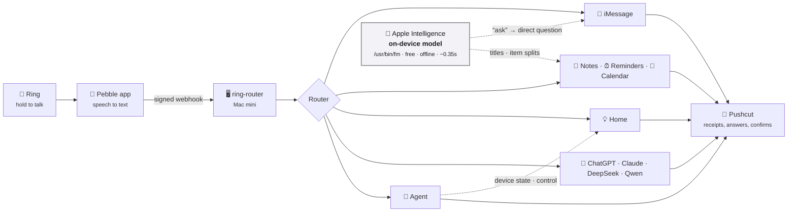

<div align="center">

# 💍 ring-router

**Say it to your ring. The Mac mini does it.**

A voice-command router for the [Pebble Index 01](https://repebble.com/index) smart ring.
Hold the button, speak, and your words become an iMessage, a note, a reminder, a calendar event,
a light switch, or a question to the AI model of your choice.


-yellow)

[How it works](#how-it-works) · [What you can say](#what-you-can-say) · [Safety](#safety) ·
[Quick start](#quick-start) · [Operating it](#operating-it) · [Testing](#testing) ·
[Status](#status) · [**Build plan →**](docs/PLAN.md)

</div>

---

## How it works



1. **The Pebble app** transcribes your recording and POSTs it, HMAC-signed, to one webhook.
2. **ring-router** verifies it: secret path, signature, timestamp, de-duplication, and how long ago
   you actually said it.
3. **The router** checks, in order: a cancel phrase → an exact scene → a fixed command → a refusal →
   the general agent. Fixed commands never touch a cloud model.
4. **The handler** acts, and **Pushcut** tells you what happened.

Three ideas hold it together:

| | |
| --- | --- |
| 🎙️ **Push-to-talk means intent** | The ring only listens while you hold the button, so what you say runs, including "unlock the front door". Confirmations are opt-in per action. The built-in check is about *who*, not *what*: messages only go to people on your allowlist. |
| 🧮 **Code decides, models assist** | Routing, recipients, device matching and dates are deterministic code with an answer key ([`tests/phrases.toml`](tests/phrases.toml)). Apple's on-device model does the small language jobs: turning *"ask Terri when she'll be home"* into *"When will you be home?"*, titling notes, splitting shopping lists. |
| 🧾 **Every command leaves a receipt** | A notification says exactly what was sent or changed, and the activity page shows each step: what was heard, how it routed, what each model said, what was sent to macOS or the house. |

---

## What you can say

**Messages**

| You say | What happens |
| --- | --- |
| *"Tell Terri I'm on my way."* | 💬 iMessages Terri: **"I'm on my way."** |
| *"Ask Terri when she'll be home."* | 💬 Rewritten on-device: **"When will you be home?"** |
| *"Hey Terri, dinner's ready"* · *"Send Terri a text saying I'm late"* | 💬 Sent as spoken: **"Dinner's ready"** · **"I'm late"** |
| *"Tell the guys let's hang out tomorrow."* | 💬 Posts to the group chat |
| *"Tell Sherry I'm on my way"* | ❓ Close to "Terri": asks **Send / Cancel** first |
| *"Tell Harry…"* · *"Tell Terri's mom…"* | 🚫 Not on the allowlist, nothing sent |
| *"Tell Terri I'll be late. Scrap that."* | 🚫 **Cancelled**, nothing sent |
| *"Tell Terri I'm on my way"* → *"Also tell her I'll grab dinner"* | 💬 "Her" = whoever you messaged in the last 10 minutes, if that recipient's `pronoun` fits; otherwise a **Send / Cancel** tap |

**Notes, lists, reminders, calendar**

| You say | What happens |
| --- | --- |
| *"Make a note: the boat trailer needs new bearings"* | 📝 New note titled **"Boat Trailer Bearings Replacement"** |
| *"Remember I parked on level 3, row G"* | 📝 Saved to the **Remember** folder |
| *"Add milk, eggs and mac and cheese to my shopping list"* | 🛒 Three reminders: Milk · Eggs · Mac and cheese |
| *"Remind me tomorrow at 5pm to call the vet"* | ⏰ Reminder; the receipt reads **"Call the vet: Fri Nov 13, 5:00 PM"** |
| *"Remind me in 20 minutes to check the oven"* · *"…on Monday to put the bins out"* | ⏰ Exactly 20 minutes on · due that day, no alert time |
| *"Remind me when I get home to take out the trash"* · *"…when I leave"* | 📍 Geofenced reminder at the address on your Contacts card (arriving or leaving) |
| *"Remind me to buy protein when I get to the gym"* · *"…when I leave work"* | 📍 Any place listed under `[places]` (an address, coordinates, or a labelled address on your Contacts card); an unknown place is refused with the known ones listed |
| *"Remind me to grab my keys when I leave here"* | 🚫 Refused: there's no access to your location, so "here" can't be known |
| *"Add dentist Tuesday at 3 to my calendar"* | 📅 The coming Tuesday at 3:00 PM ("next Tuesday" is Tuesday of next week) |
| *"Add dinner with the guys tomorrow from 6 to 8pm to our calendar"* | 📅 On the shared calendar, ending at 8 |
| *"Add Terri's birthday on December 3rd to my calendar"* | 📅 An all-day event |

**The house**

| You say | What happens |
| --- | --- |
| *"Turn off the living room lights"* · *"Kitchen lights off"* · *"Turn the lights off in the kitchen"* | 💡 Every light in that room |
| *"Set the master bedroom fan to low"* · *"Dim the sconces to 20%"* | 🌀 Fan speed (low / medium / high, through HomeKit) and dimmer levels |
| *"Turn on the living room fan"* | 🌀 "Fan" means the ceiling fan when several match; otherwise it asks "Which one?" |
| *"Lock the laundry room door"* · *"Unlock the front door"* · *"Open the front garage door"* | 🔒 Any lock or garage door in HomeKit, run as spoken (confirm-first is opt-in) |
| *"Is the laundry room door locked?"* | 🔒 Lock and door state (through the general agent's home tools) |
| *"Set the guest bedroom fan to high"* | 🏷️ Your own names: nicknames for devices and rooms in `[home]` (here "guest bedroom" = HomeKit's Guest Room) |
| *"Turn off everything"* | 💡 Everything switchable except outlets and plugs |
| *"Goodnight"* (the whole phrase) | 🌙 A scene: a fixed list of device actions |
| *"Is the garage door closed?"* · *"Which kitchen lights are on?"* | 🧠 The agent reads the device state |

**Questions and everything else**

| You say | What happens |
| --- | --- |
| *"Ask DeepSeek what's the best Chinese restaurant near me"* | 🤖 Web-backed answer as a notification, full text and sources a tap away |
| *"Ask DeepSeek more about that"* | 🤖 Continues the conversation (within 10 minutes) |
| *"Research the best robot vacuum under $500"* | 🔎 A research note in Apple Notes |
| *"What's on my calendar Thursday?"* | 🧠 The general agent reads your calendar |
| *"Move my dentist appointment to next week"* | 🧠 The agent finds it and moves it |
| *"What's the best Chinese restaurant in Charleston?"* → *"Which of those is cheapest?"* | 🧠 Web search; follow-ups keep the thread |
| *"Okay Mark, thanks, see you later… ask DeepSeek what color is the sky"* | 🧹 The agent spots the buried command and hands it back, word for word |
| *"Ask Claude Code on the RackNerd VPS why the websites are down"* · *"Ask Claude on the home server why Plex is down"* | 🛠️ Claude Code on that host looks into it (read-only) and answers; naming a host is what makes "Claude" mean Claude Code |
| *→ "Go ahead"* (or the **Proceed** button) | 🛠️ If it proposed a fix, the same session makes the change and reports back. Nothing waiting → refused |
| *→ "Ask Claude on the home server what changed last night"* | 🛠️ Follow-ups within 15 minutes continue the same Claude Code session |
| *"Set a timer for 10 minutes"* | 🚫 Refused: timers and alarms aren't supported |

---

## Safety

<details open>
<summary><b>Who gets a message</b></summary>

- **Allowlist only.** Messages go to the people and chats in your config, nobody else.
- **Near misses ask.** A name spelled *and* sounding like one of yours ("Sherry", "Jerry" for Terri)
  gets a **Send / Cancel** tap. "Troy", "Terri's mom" and "the guy at the door" are refused.
- **No guessing at numbers.** The number is the `handle` in your config, or the one Contacts card
  with that exact name. No card, or two, and nothing is sent.
- **"Tell" is verbatim.** Only "ask X…" is rewritten, and the receipt shows the exact text sent.
- **Cancel by voice.** End any command with "scrap that", "never mind", "cancel cancel"… It always
  cancels, so "tell Terri never mind" can't be sent as a message (a known limit).
- **"Tell her…" means the last person you messaged**, within `[messages] followup_window_s` (10
  minutes). It sends straight away only when the pronoun matches that recipient's `pronoun` (a group
  chat is "them"); a mismatch or an unset pronoun gets a **Send / Cancel** tap, and with nobody
  messaged recently nothing is sent.
- **Continuations are fine.** A leading "also", "and", "plus", "then" or "oh, and" is ignored, for
  every kind of command.

</details>

<details>
<summary><b>What runs, and when</b></summary>

- **Dry run by default**, globally and per route, plus `live_recipients` to limit real sends while testing.
- **Optional confirm-first actions.** List home actions (e.g. `unlock`, `open`) in
  `[home] confirm_actions` to require a tap. Empty by default.
- **Old recordings ask first.** A message or home command that arrives more than 5 minutes after you
  said it gets a **Run / Cancel** tap instead of running.
- **Nothing runs twice.** A command ends as done, **failed** (nothing happened), **partial** (the
  notification says which part) or **unknown** (no answer in time). Retry in the Pebble app reruns
  only a *failed* one. A command cut off by a restart is reported, not rerun.
- **Nothing hangs.** Each call into macOS or HomeKit gets 60 seconds, so a stuck permission prompt
  can't stall a command.
- **Buttons act only when tapped.** `/confirm` accepts POST only, so a link preview can't send or
  unlock anything.

</details>

<details>
<summary><b>What the agent can do</b></summary>

- **It can't text or email.** It gets calendar, reminders, notes, contacts, web search and home
  devices. Allowed tools *and actions* are enforced in code, not just in the prompt.
- **It only changes what you asked to change.** Update, delete and device control need your own
  words to call for them, so nothing it reads in an invite or on a web page can trigger them. One
  delete and five device actions per request.
- **Unlock and open through the agent always ask**, as does anything it digs out of background
  talk. "Don't unlock the door" is never handed back as a command.
- **It stops.** A run ends after 12 model calls, and its cost shows on the activity page.

</details>

<details>
<summary><b>The house</b></summary>

- **Ambiguous means ask.** "Turn off the living room fan" with two fans changes nothing and asks
  which. "Open the door" does not open the garage.
- **Hands off.** Detectors, alarms and sirens are never controlled; `[home] exclude` lists anything
  else, on either backend, and `[homekit] exclude_rooms` hides whole rooms (e.g. a "Virtual" room of
  switches that drive automations). "Everything" spares outlets and plugs.
- **Your names, not HomeKit's.** `[home] aliases` maps a whole spoken name to a device ("towel
  warmers" → Master Bathroom Towel & Mirror Warmers); `[home] room_aliases` maps a room name anywhere
  in a phrase ("guest bedroom" → Guest Room); `[home] prefer` breaks ties ("fan" → the ceiling fan).
  Naming a room keeps the match inside it, so "the guest room ceiling fan" never finds another
  room's ceiling fan.
- **HomeKit is enough.** Lights, dimmers, fans (speeds included), locks and garage doors all work
  through HomeKit, including Z-Wave devices bridged in from Hubitat. The Hubitat Maker API module
  (`[hubitat] enabled`) is optional; this install has it off. Fans bridged from Hubitat need their
  driver's speed list filled in (run **Configure** on the device in Hubitat once), and "high" is
  sent as 99%, because Hubitat's integration treats 100% as "on, keep the current speed".
- **Optional read-back.** With `[home] read_back = true`, lock, unlock, open and close wait for the
  device and report what it did: "Front Door locked (confirmed)", or "was told to lock but reports
  unlocked". Off by default, because the command then waits on the device.

</details>

<details>
<summary><b>Dates and times</b></summary>

The on-device model is poor at calendars: tested on 22 spoken dates it got 12 right ("Tuesday" came
back as a Saturday), and a longer prompt didn't help. So the time is worked out in code from your
words, and the model supplies only the title. For phrases the code can't read (a holiday, "the end
of the month") the model's date is used and the receipt says **"check the date"**. Receipts always
show the weekday.

</details>

---

## Quick start

> **Requires** macOS 27 (for `/usr/bin/fm`), Python 3.11+, Node (for the vendored
> [mcp-macos](https://github.com/krmj22/macos-mcp)), and [Pushcut](https://www.pushcut.io) on your phone.

```sh
git clone https://github.com/DaveLinger/ring-router.git && cd ring-router
python3 -m venv .venv && .venv/bin/pip install -e '.[dev]'
vendor/setup.sh                      # pinned mcp-macos: install, patch, build its EventKit helper

cp config.example.toml config.toml   # recipients, models, lists, calendars, scenes (git-ignored)
.venv/bin/ring-router init           # path token, signing secret and activity token into .env
.venv/bin/ring-router route "Tell Terri I'm on my way"    # try it: dry run, nothing is sent
```

Everything starts in **dry run**. Set `[server] dry_run = false` when the receipts look right.

### Run it as a service

```sh
app/build.sh                         # build/Ring Router.app: one macOS identity for every permission
helpers/georeminder/build.sh         # build/georeminder: location reminders
cp launchd/local.ring-router{,.watchdog,.selftest}.plist ~/Library/LaunchAgents/
for job in local.ring-router local.ring-router.watchdog local.ring-router.selftest; do
  launchctl bootstrap gui/$(id -u) ~/Library/LaunchAgents/$job.plist
done
```

Then publish it (next section), set `[server] public_url` to the Funnel address, and restart after
code or config changes with `launchctl kickstart -k gui/$(id -u)/local.ring-router`.

### Publish only what must be public

The Pebble app and Pushcut reach the Mac through [Tailscale Funnel](https://tailscale.com/kb/1223/funnel).
Four paths need to be on the internet: `/hook` (the Pebble app), `/confirm` (Pushcut buttons),
`/answers` ("Full answer" links) and `/health` (the watchdog). The activity page shows every
transcript and message, so it is served to your own tailnet only, on a second port. (Funnel is
switched on per port, which is why it needs one.)

```sh
for p in hook confirm answers health; do
  tailscale funnel --bg --set-path /$p http://127.0.0.1:8642/$p
done
tailscale serve --bg --https=10000 --set-path /activity http://127.0.0.1:8642/activity   # tailnet only
tailscale funnel status
```

The activity page is then `https://<your-mac>.ts.net:10000/activity/<token>`, from devices signed
in to your tailnet. On macOS the CLI is `/Applications/Tailscale.app/Contents/MacOS/Tailscale` if
`tailscale` isn't on your PATH. If you started with `tailscale funnel --bg 8642` (everything
public), remove that mount with `tailscale funnel --https=443 --set-path / off`. Don't use
`tailscale funnel reset` if other ports on the machine are funnelled: it clears them all.

<details>
<summary><b>Why "Ring Router.app", and granting macOS permissions</b></summary>

macOS grants privacy permissions (Local Network, Calendars, Reminders, Contacts, Automation, HomeKit)
to the *responsible app*. A Homebrew Python started by launchd has no app identity, so macOS Local
Network privacy silently blocks it ("No route to host" to the Hubitat hub). `app/` builds a small
signed launcher, **Ring Router.app** (`local.ring-router`), that starts the listener as a child and
stays its parent. Every permission then lives under one "Ring Router" entry in System Settings and
survives Homebrew Python upgrades.

To trigger and verify the prompts from that same context:
`launchctl bootstrap gui/$(id -u) launchd/local.ring-router.permcheck.plist` runs
`ring-router check-permissions` (log: `~/Library/Logs/ring-router-permcheck.log`). Calendars needs
**Full Access**, not "Add Events Only".

mcp-macos is vendored in `vendor/` because npm blocks the install script that compiles its EventKit
helper, and because ring-router patches that helper (`vendor/patches/`): `[calendars] sources =
["iCloud"]` hides other accounts, such as a Google account that calsync mirrors into iCloud, which
would otherwise make every event appear twice.
</details>

### Configuration

| File | What's in it | In git? |
| --- | --- | --- |
| `config.toml` | Recipients, models, lists, calendars, home, scenes, cancel phrases, dry-run flags | ❌ copy from `config.example.toml` |
| `.env` | Path token, signing secret, activity token, API keys (mode 600) | ❌ see `.env.example` |
| `prompts.toml` | **Every instruction given to a model**, marked LIVE or DRAFT | ✅ |
| `profile.md` | Facts about you added to every cloud-model prompt (location for "near me") | ❌ see `profile.example.md` |
| `tests/phrases.toml` | The answer key: phrases, how they must route, what they send | ✅ |

Add keys with `ring-router set-secret openrouter_api_key` (or `pushcut_webhook_url`,
`hubitat_token`), or edit `.env`. For Pushcut, the notification's Webhook URL is enough.

---

## Operating it

| Command | Does |
| --- | --- |
| `ring-router serve` | Run the listener |
| `ring-router route "phrase"` | Route a phrase and show what would happen (dry run). Cloud-model routes only run with `--online` |
| `ring-router sim "phrase" …` | Send phrases to the running listener exactly as the ring would |
| `ring-router recent` | Recent deliveries |
| `ring-router selftest` | Read-only check of every backend; Pushcut alert when one fails |
| `ring-router watchdog` | One health check of the listener and the tunnel; Pushcut alert on change |
| `ring-router check-permissions` | Touch each macOS app once (run via the permcheck launchd job) |
| `ring-router init` · `set-secret <name>` | Generate or set secrets in `.env` |

**Keeping an eye on it**

- **Activity page** at `/activity/<activity_token>` (tailnet-only port, see above): recent commands with outcome and model cost.
  Tap one for its step-by-step trace: the exact transcript, the route decision, what the on-device
  model was given and returned, the date the code settled on, every agent tool call, device matches,
  each command sent to macOS or the house with its result, and the reply the Pebble app saw.
- **Watchdog**, every 5 minutes: is the listener up, is the tunnel up. Alerts after two failed
  checks and once on recovery. It runs on the same Mac, so it can't report the Mac being off.
- **Self-test**, daily at 04:10: reads from Calendar, Reminders, Notes, Contacts, the on-device
  model and the home backends, with the service's own permissions. It catches what otherwise fails
  silently, such as a macOS update resetting a privacy grant. Nothing is created and no cloud model
  is called.
- **Housekeeping:** logs in `~/Library/Logs/ring-router*.log` are cut back to their last 1 MB once
  they pass 5 MB. Activity, saved answers and conversations are deleted after 90 days
  (`[server] retention_days`).

---

## Testing

`ring-router sim` builds the same signed multipart request the Pebble app sends, so the whole
pipeline runs end to end without a ring:

```console
$ ring-router sim "Ask Terri when she'll be home." "Tell Sherry I'm on my way"
▶ Ask Terri when she'll be home.
  ← 200 dry_run: [imessage] DRY RUN: would send to Terri (rewritten): 'When will you be home?'
▶ Tell Sherry I'm on my way
  ← 200 needs_confirm: [imessage] weak match 'sherry' -> Terri; confirmation Cf6-iuBYDYrgXUpe
```

Flags: `--test-event`, `--replay` (dedupe), `--bad-signature`, `--audio`, `--trigger double-click-hold`,
`--recorded-ago 3600` (an old recording), `--file tests/phrases.toml` (the whole answer key).

```sh
.venv/bin/pytest -q               # everything (482 tests)
.venv/bin/pytest -m "not live"    # skip the tests that call the real on-device model
.venv/bin/pytest -m live          # only those: exact message text, and reminder and calendar
                                  # times with the real model in the loop
```

| Where | What it pins down |
| --- | --- |
| [`tests/phrases.toml`](tests/phrases.toml) | The answer key: each phrase, its route, the text pulled out, and for messages the exact text sent. Add phrases as you think of them; the tests fail until the router agrees. |
| [`tests/test_when.py`](tests/test_when.py) | Dates and times from spoken words, no model involved |
| [`tests/test_review_fixes.py`](tests/test_review_fixes.py) · [`test_failures.py`](tests/test_failures.py) | What happens when something breaks. To record an open issue, add a strict `xfail` test here; fixing it later fails the run until the marker is removed. |
| [`tests/test_extract_live.py`](tests/test_extract_live.py) | The real model in the loop, plus five expected failures showing what it answers on its own |

---

## Status

| Piece | State |
| --- | --- |
| Webhook checks: secret path, HMAC v1, ±5 min, dedupe, old-recording gate | ✅ Done (the real ring's format still needs checking against real traffic) |
| Router: cancels, scenes, fixed commands, recipient tiers, refusals | ✅ Done; 117 phrases in the answer key |
| On-device model: "ask" rewrites, note titles, item splits, reminder and event titles | ✅ Done (real model) |
| Dates and times in code (`when.py`), the model as flagged fallback | ✅ Done; 21 of 21 live cases right |
| iMessage / Notes / Reminders / Calendar / Contacts via mcp-macos | ✅ Live end to end through the tunnel; real sends still limited to the owner (`live_recipients`) |
| Pushcut notifications and buttons | ✅ Send/Cancel and Full answer verified through the tunnel |
| Ask a model, research notes: OpenRouter, web search, follow-ups, answer page | ✅ Live-tested with all four models; saving a research note waits on the Notes permission |
| General agent: macOS tools, web search, follow-ups, `run_command`, write-intent gate | ✅ Live: read the real calendar, then moved an event as a follow-up |
| Home: HomeKit via a patched HomeMCPBridge, Hubitat as an optional module | ✅ Live for lights, dimmers, fans (speeds included), garage doors and locks; this install runs HomeKit only |
| HomeKit-only locks (e.g. Laundry Room Door) | ✅ Live: lock, unlock and lock state verified on the Laundry Room Door (the bridge patch now uses HomeKit's lock-mechanism characteristics) |
| Tailscale Funnel limited to `/hook`, `/confirm`, `/answers`, `/health`; activity page tailnet-only | ✅ Live |
| Location reminders ("when I get home / when I leave") | ✅ Live: geofence from your Contacts card, verified on the iPhone |
| Named places for location reminders (`[places]`), "here" refusal | 🟡 Tested with a faked helper; refusals checked live; no place configured on this install yet |
| "Tell her…" follow-ups, leading "also/and" | ✅ Checked end to end through the live service (Terri sends are dry runs while `live_recipients` is only you) |
| Activity page, watchdog, Ring Router.app, Tailscale Funnel, launchd service | ✅ Live |
| Daily self-test | ✅ Installed; first run passed all eight checks |
| Agent home tools | ✅ Live on the Laundry Room Door: "Is it locked?" (status), "get it locked" (runs), "unlock it" (held for a Send tap, then ran) |
| Lock and door read-back (`[home] read_back`) | ✅ Live: "Laundry Room Door locked (confirmed)" / "unlocked (confirmed)" end to end (still off by default) |
| HomeKit fan speeds, device and room nicknames | ✅ Live: low / medium / high verified on all four ceiling fans; "set the guest bedroom fan to high" etc. run end to end |
| Claude Code per host (Mac mini, TrueNAS, RackNerd VPS, Contabo VPS) | ✅ Live: a read-only question answered on each host, on the Claude subscription. Proceed / "go ahead" tested with a faked CLI only (nothing needed fixing yet) |

See the **[build plan](docs/PLAN.md)** for the design, the reasoning behind each decision, and the
roadmap. Notes for AI assistants working in this repo are in [CLAUDE.md](CLAUDE.md).

---

## Project layout

```text
ring-router/
├── src/ringrouter/
│   ├── server.py      # HTTP listener, status codes, background jobs, confirmations
│   ├── protocol.py    # Pebble webhook v1: verify, parse, and build (for the simulator)
│   ├── router.py      # transcript → Route (pure function of text + config)
│   ├── recipients.py  # allowlist matching: strong / weak / unknown
│   ├── cancel.py      # trailing cancel-phrase detection
│   ├── when.py        # dates and times worked out from the spoken words (pure functions)
│   ├── handlers/      # one handler per route; dry run enforced here
│   │   ├── __init__.py  #   route table, run(), run_confirmed()
│   │   ├── context.py   #   Context, Result, activity-trace wrappers
│   │   ├── messages.py  #   iMessage: compose, confirm, resolve the recipient, send
│   │   ├── apple.py     #   notes, lists, reminders (timed + geofenced), calendar
│   │   ├── home.py      #   device catalog, commands, read-back, confirmations, scenes
│   │   └── models.py    #   ask-a-model, research, the general agent
│   ├── agents.py      # the general agent (Pydantic AI): tools, guards, limits
│   ├── fm.py          # Apple on-device model wrapper (greedy)
│   ├── llm.py         # OpenRouter client, follow-up memory, answer store
│   ├── places.py      # named places for location reminders
│   ├── hubitat.py     # device catalog and spoken-name matching; Hubitat Maker API
│   ├── homekit.py     # HomeKit via HomeMCPBridge; the combined catalog
│   ├── mcp.py         # minimal stdio MCP client (with a hard timeout)
│   ├── activity.py    # activity page + per-command trace view
│   ├── watchdog.py    # down alert
│   ├── selftest.py    # daily read-only check of every backend
│   ├── logfile.py     # keeps the launchd log files bounded
│   ├── md.py          # Markdown → HTML for the answer page and research notes
│   ├── notify.py      # console + Pushcut notifiers
│   ├── store.py       # SQLite: deliveries, trace, pending confirmations
│   ├── prompts.py     # loads prompts.toml
│   ├── config.py      # config.toml + .env
│   └── cli.py         # the ring-router command
├── app/               # Ring Router.app launcher (Swift) + Info.plist + build.sh
├── helpers/georeminder/  # Swift: geocode + EventKit location reminder
├── launchd/           # listener, watchdog, self-test and permission-check jobs
├── vendor/            # pinned mcp-macos + HomeMCPBridge build script and patches
├── tests/             # the answer key and the test suite
├── docs/PLAN.md       # build plan and decisions
├── prompts.toml       # all model instructions
├── config.example.toml
└── .env.example
```
