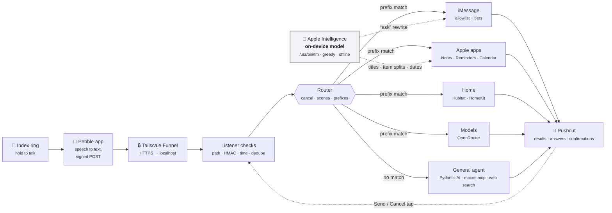

# Ring Router — Build Plan

A small listener on the Mac mini takes voice transcripts from the **Pebble Index 01** ring and routes
each one to the right action: iMessage, Notes, Reminders, Calendar, home devices, or an outside AI
model. Answers and confirmations come back as **Pushcut** notifications.

> **Status (Nov 2026):** phases 1–2 skeleton built and tested in dry run; see the
> [README](../README.md#status) for what's real vs stubbed. This plan records the decisions.

**Contents:** [Goals](#goals) · [How the Index sends data](#how-the-pebble-index-sends-data) ·
[Architecture](#architecture) · [Routing & safety](#routing-and-recipient-safety) ·
[Route catalog](#route-catalog) · [Additional routes](#additional-routes) ·
[General agent](#general-agent) · [Timers](#timers-and-alarms-refused) ·
[On-device model](#on-device-apple-model) · [Home](#home-automation) ·
[External models](#external-models) · [Responses](#responses-and-confirmations) ·
[Security](#security-and-permissions) · [Phases](#build-phases) · [Open questions](#open-questions-and-risks) ·
[Sources](#sources)

---

## Goals

- Common commands ("tell Terri I'm on my way") run with **no cloud LLM** in the path: fast, cheap, predictable.
- Anything that doesn't match a prefix goes to a **general agent** with the macOS tools.
- Messages only go to **allowlisted** people and chats; a near-miss name needs a confirmation.
- **Push-to-talk means intent:** the ring only listens while the button is held, so commands run as
  spoken, including unlock and garage-open. Confirm-first is opt-in per action (`[home] confirm_actions`).
- Both home automation paths, **Hubitat** and **HomeKit**, can be tested side by side.

**Not in scope:** email (the macos-mcp mail tools are left out; Gmail if ever needed), and anything
sent back to the ring itself, which has no screen or speaker.

---

## How the Pebble Index sends data

The phone app transcribes, then POSTs to **one** custom webhook. Nothing comes back to the ring.
Details come from Pebble's docs and community receivers; phase 0 confirms them against real traffic.

| Aspect | What we know |
| --- | --- |
| Where transcription runs | On the phone. Local mode is a one-time ~670 MB download; cloud mode uses Wispr Flow; each can fall back to the other. |
| Webhook slots | One, under the Index tab in the app. |
| Ring button routing | "Webhook only", or a built-in action plus "Also send to webhook". **Webhook only** avoids duplicate notes and reminders. |
| What to send | "Transcription only". "Recording only" sends no text. |
| Format | `multipart/form-data`, protocol v1 |
| Fields | `transcription`, `recordedAt` (Unix ms), `audio` (m4a, ignored), `client`, `test` |
| Headers | `X-Index-Webhook-Version` (`1`), `X-Index-Timestamp` (Unix s), `X-Index-Delivery` (recording ID, reused on retries), `X-Index-Trigger` (`single-click-hold`, `double-click-hold`, `test-event`), `X-Index-Test`, `X-Index-Signature` |
| Signing | HMAC-SHA256 hex over `v1\n{timestamp}\n{delivery}\n{trigger}\n{1\|0}\n` + raw body. Secret pasted into the app's "Sign requests" setting. |
| Retries | A **503** is retried every minute, up to 10×. 200, 4xx and 422 are not retried automatically. |
| Reply to user | None. The app shows only the status code in Recent runs. |

### Request handling

Adapted from [th3walkingdud3/peeble-ring-router](https://github.com/th3walkingdud3/peeble-ring-router):

1. Secret URL path (`/hook/<token>`); a wrong path gets **404**.
2. Constant-time HMAC check and a ±5-minute timestamp window; failure gets **401**.
3. Test events get 200 and run nothing; other triggers are ignored.
4. De-duplicate by `X-Index-Delivery` in SQLite; repeats get 200 and don't run again. One exception:
   a delivery that ended **failed** (nothing happened) runs again when it is resent, which is what
   the app's Retry does. **partial** (some of it happened) and **unknown** (no answer in time) never
   rerun. A job still in flight when the service stops is marked unknown at the next start and the
   owner is told; it is not run again.
5. Parse the multipart body; drop the audio part.
6. A send that times out is marked `unknown`, gets **422**, and is **never re-sent automatically**.
   Every mcp-macos / HomeMCPBridge call from the fixed routes has a hard 60-second limit (the server
   is killed), so a privacy prompt nobody can click doesn't hang the request. (The agent's own MCP
   session uses Pydantic AI's 180-second tool timeout.)
7. Global and per-route dry run, plus a simulator that sends signed fake requests.

**What we add:** slow routes (models, agents) store the job, reply `200 accepted` immediately, and
finish in the background; the result arrives by Pushcut.

**Old recordings:** `recordedAt` says when the words were spoken. A message, home command or scene
older than `[server] max_recording_age_s` (5 minutes) is held with a **Run / Cancel** notification
rather than run: holding the button meant "now". Other routes run, and reminder and calendar dates
are worked out from the spoken time. A `recordedAt` that is missing or not believable (the future,
over a month old) is ignored. *Assumption until real ring traffic is seen: the field is Unix
milliseconds and the ring can deliver recordings late.* Test with `ring-router sim --recorded-ago 3600`.

---

## Architecture

One Python service on the Mac mini. It listens on localhost only; Tailscale Funnel brings requests in;
launchd keeps it running, like `calsync`.

Fast fixed routes reply to the Pebble app with their real result; slow routes reply "accepted".
A confirm tap in Pushcut calls back into the listener to run the pending action.

---

## Routing and recipient safety

The router is a pure function of (transcript, config). Order:

1. **Cancel phrase** at the end → nothing runs.
2. **Scene**: exact whole-transcript match only.
3. **Fixed prefix routes**, most specific first.
4. **Refusals** (timers, alarms).
5. **Anything else**, question or request → general agent.

### Cancel detection

If a transcript ends with a cancel phrase, nothing runs; Pushcut says "Cancelled, nothing done".

| Strength | Example phrases | Cancels when |
| --- | --- | --- |
| Strong | "cancel cancel", "cancel that", "scrap that", "never mind", "ignore me", "abort" | They end the transcript, or are all of it |
| Weak | "forget that", "don't do that", "stop", "cancel" | They end the transcript **and** follow a sentence break |

"Tell Terri I'll be late. Scrap that." is cancelled; "Tell Terri to forget that" sends.

**Later:** a separate "cancel" recording cancels the most recent unfinished action, and mid-sentence
corrections ("…scrap that, tell Terri I'm on my way") run only the part after the cancel phrase.

### Taking back a sent message (deferred)

**Decision (Nov 2026):** strong-match messages send immediately. Both options below are parked;
revisit if real use shows a need.

| Option | How | Trade-off |
| --- | --- | --- |
| **Send delay** | Each message waits a few seconds; a "cancel" in that window stops it | Reliable for SMS and any device; every message arrives slightly later (per-recipient, can be 0) |
| iMessage **Undo Send** (experiment) | UI-scripts Messages' own Undo Send | Messages' AppleScript only has `send`, so it's fragile; needs Accessibility and a logged-in session; 2-minute window; old OS versions still see the original |

### Recipient tiers

| Tier | Example | Action |
| --- | --- | --- |
| 1. Allowlisted, strong match | "tell terri…", "tell terry…" | Send, then a receipt notification |
| 2. Allowlisted, weak match | "tell sherry…" | Pushcut confirmation: **Send / Cancel** |
| 3. Not allowlisted | "tell harry…" | Never sent: "Didn't recognize 'harry', nothing sent." |
| 3b. *(later)* LLM guess | "tell harry…" | Suggests who you meant from message recency; you confirm |
| Pronoun follow-up | "tell her…", "let him know…", "ask them…" | The last recipient within `[messages] followup_window_s` (600 s): sends if the pronoun fits their `pronoun` (a group chat is "them"), else **Send / Cancel**; nobody recent → refused |

**Pronoun follow-ups** ("Tell Terri I'm on my way" → "Also tell her I'll grab dinner"). The router keeps
no state, so "tell her/him/them" routes to `imessage_followup`, and the handler looks up who was
messaged last (recorded on every send, dry run or status-unknown send). A pronoun that doesn't fit
that recipient, or a recipient with no `pronoun` set, gets a tap rather than a guess; the same is
true when the agent picked the command out of background noise. A leading "also", "and", "plus",
"then" or "oh, and" is stripped before routing, for every route.

A near miss (tier 2) must be spelled alike **and** sound alike, and either end the same way ("Jerry",
"Sherry" for Terri) or be very close ("Instincts"). "Troy" and "Tara" share only T-R with Terri and are
refused; so is a possessive ("Terri's mom") and, for multi-word names, anything whose last word doesn't
sound the same ("the guy", "the gym" for "the guys"). A bare name with no verb needs a pause after it
("Instinct, ..."). "Ask <unknown name> what/about ..." goes to the agent ("ask Google what time it is").
A command ending in a strong cancel phrase is always cancelled, so "tell Terri never mind" can't be
sent as a message: a known limit, accepted to keep cancelling simple and independent of punctuation.

Names match by spelling **and** sound. "Hey X" / "X, …" is direct speech (sent as spoken); only
"ask X…" is rewritten into a direct question. "Tell X to grab milk" sends "Grab milk".

**Where it goes:** the recipient's `handle` in the config (recommended), or else the Contacts card
named in `contact`: exactly one card must have that name, and only its Phone / Email lines are read
(mobile first). No card, several cards, or no usable number means "Not sent", never a guess.

---

## Route catalog

| # | You say | Handler | LLM | Backend |
| --- | --- | --- | --- | --- |
| 1 | "Ask Terri when she'll be home" | Rewrite into a direct question, iMessage | on-device | macos-mcp `messages_chat` |
| 2 | "Instinct…", "hey / ask / tell Instinct…" | iMessage ("ask" rewritten) | on-device for "ask" | macos-mcp `messages_chat` |
| 3 | "Tell Terri I'm on my way" | iMessage, words as spoken | none | macos-mcp `messages_chat` |
| 4 | "Tell the guys let's hang out tomorrow" | Group chat by chat ID | none | macos-mcp `messages_chat` (`chatId`) |
| 5 | "Make a note: …" | New note, titled by on-device summary | on-device | macos-mcp `notes_items` |
| 6a | "Remind me at 5 to call the vet" | Extract title + due time | on-device | macos-mcp `reminders_tasks` |
| 6b | "Remind me when I get home to…" | Location trigger | on-device | Custom Swift EventKit helper (macos-mcp can't) |
| 7 | "Add dentist Tuesday at 3 to my calendar" | Extract title, time, calendar | on-device | macos-mcp `calendar_events` |
| 8 | "Turn off the living room lights" | Device/room match + action (deterministic) | none | HomeMCPBridge (HomeKit); Hubitat Maker API optional |
| 9 | "Ask ChatGPT / Claude / DeepSeek / Qwen …" | Prefix picks the model | yes | OpenRouter |
| — | anything else (questions too) | General agent | yes | Pydantic AI on OpenRouter + macos-mcp + web search |

Date extraction always includes today's date and time zone. The macos-mcp mail tools are never exposed.

---

## Additional routes

| Route | You say | Output |
| --- | --- | --- |
| **Claude Code per host** | "Ask Claude Code on the RackNerd VPS why the websites are down" | Headless `claude -p` locally or over SSH; Pushcut summary |
| **Shopping list** | "Add milk and eggs to my shopping list" | One reminder per item in the Reminders list "Shopping list" |
| **Remember** | "Remember I parked on level 3, row G" | A new note in the "Remember" folder |
| **Scenes** | "Goodnight" (the entire transcript) | Fixed device actions |
| **Research** | "Research the best robot vacuum under $500" / "Research with DeepSeek…" | A note in the "Research" folder; Pushcut just says it's ready |

- **Claude Code:** hosts and spoken names are in config; unknown hosts are refused; default is the
  Mac mini. "Ask" and "tell" mean the same thing; what Claude Code may do is set per host in config, not by wording.
- **Shopping list:** on-device structured output splits items, so "mac and cheese" stays one item.
  If an item fails the rest are still tried, and the notification lists what was added and what
  wasn't; if Reminders stops answering, the remaining items are not tried.
- **Location reminders:** home (the Contacts My Card address) plus any place under `[places]`, each with
  spoken names and an address, coordinates, or a My Card label (`contact_label = "work"`); optional
  `radius_m`. Parsing is in `places.py` (pure, shared by the router and the handler). An unknown place
  ("when I get to the bank") is refused with the known places listed, never turned into a home
  geofence. "When I leave here / arrive here" is refused: ring-router has no access to your location,
  so it can't know where "here" is. "When I get to it" and "when I get a chance" are not places.
- **Remember:** one note each, because macos-mcp caps note bodies at 2,000 characters.
- **Research:** like "ask ChatGPT" but the output is a note; written via AppleScript to avoid the 2,000-character cap.

---

## General agent

**Every transcript that matches no fixed route goes to one general agent**, questions and requests
alike. An earlier design split off a read-only "questions agent", but routing by sentence shape broke
on natural speech: "Can you add the cheapest one to my calendar?" looks like a question and would have
landed on an agent that couldn't write. One agent with a shared conversation thread avoids that.

| Tool | Allowed actions |
| --- | --- |
| Calendar | read, create, update, delete |
| Reminders | read, create, update, delete |
| Notes | read, create, update |
| Contacts | read, create, update |
| web_search | the agent writes its own query; one OpenRouter web-plugin call (`[agents] web_search_model`) |
| run_command | hands a noise-trimmed, word-for-word command back to the router (see below) |
| home_status | reads what devices report: locked, open, on, level (`[agents] home_tools`) |
| home_control | on, off, set, dim, brighten, lock, unlock, open, close, through the same matcher as a spoken command (see below) |
| Messages | read only, and only if `[agents] read_messages = true` (needs Full Disk Access) |
| Mail | none |

- Tools not in the table are invisible. Each mcp-macos tool takes an `action` argument, so a guard checks
  every call and refuses anything not allowed. In dry run, writes return "DRY RUN: would…".
- **Write-intent gate:** `update` and `delete` run only when the user's own words (this request or
  earlier turns of the thread, never tool output or the agent's replies) contain a word that asks for
  a change: "move", "cancel", "remove", "mark… done" and the like (`WRITE_INTENT` in `agents.py`).
  A question such as "What's on my calendar Thursday?" therefore can't end in a deletion, whatever an
  invite or web page says. Deletes are capped at `[agents] max_deletes` (1) per request. Cost: an
  implied change ("I already called the vet") is refused; say "mark it done", or set
  `[agents] require_write_intent = false`.
- **Background noise → `run_command`:** if a transcript like "okay Mark, thanks, see you later… ask
  deepseek what color is the sky" misses every prefix, the agent can hand the buried command back to
  the top of the pipeline, where it gets normal routing, allowlist, tiers, cancels and dry run. Safeguards
  in code: the command must be a **word-for-word excerpt** of the transcript (the agent can trim noise,
  never add or change words); an excerpt that follows a negation in the transcript ("don't unlock the
  front door", "I told her not to open the garage") is refused; a command that routes back to the
  agent is refused; once per request; a rerouted *message* needs a Send/Cancel tap
  (`[agents] confirm_rerouted_messages`), and so does a rerouted unlock or garage-open
  (`[agents] confirm_rerouted_home`; spoken directly, those still just run); the rerouted route sends
  the only notification.
- **Home tools:** "Is the garage door closed?" and "Kitchen lights off" miss every fixed prefix, so
  the agent gets `home_status` and `home_control`. Control is not a second code path: it calls the
  home route's own `run_home`, so the deterministic matcher, ambiguity refusal, exclusions, dry run
  and notifications are the same. On top of that, in code: the user's words (not tool output) must
  be about controlling something; at most `[agents] max_home_actions` (5) per request; unlock and
  open through the agent always need a tap (`[agents] confirm_rerouted_home`), unlike the spoken
  command. `home_status` reads at most eight devices per call (each HomeKit read starts the bridge).
- **Follow-ups:** the agent keeps one conversation thread (10-minute window), passed as message history,
  so "Which of those is cheapest?" or "Why isn't the Tesla Model S Plaid on this list?" work naturally.
- Instructions combine the spoken-transcript preamble, `profile.md`, `prompts.toml` and the current date/time.
- **Limits and cost:** a run stops after `[agents] max_requests` (12) model calls, with a "Not done"
  notification. What the run cost (the agent model plus its web searches, as OpenRouter reports it)
  is recorded in the trace and counted in the activity page's per-command cost.
- Default model: `anthropic/claude-sonnet-5.5` (`[agents] model`), about 2–5¢ per request.
- **Instinct:** the agent can't message anyone. If it can't finish a request (e.g. it needs someone else's
  availability) it suggests a command, such as "ask Instinct to find a time for you and Terri".

**Decisions still open**

- [ ] Messages reading: needs Full Disk Access, granted per program, so a small wrapper app is safer.
- [ ] Private text goes to the model: use OpenRouter's no-training/no-retention provider settings.
- [ ] Gmail and Google Drive: in or out?

## Timers and alarms: refused

The Mac can't set the iPhone's Clock timers or alarms, and substitutes aren't worth having.

- "Set a timer", "timer for", "wake me at", "set an alarm" hit a **refusal** before any agent; Pushcut
  says "Timers and alarms aren't supported from the ring".
- The general agent has no scheduling tool and is told to decline rather than make a reminder instead.
- *Optional experiment:* Focus mode via a Mac Shortcut that syncs to the iPhone ("Share across devices").

---

## On-device Apple model

macOS 27 ships Apple's on-device model as `/usr/bin/fm`: free, offline, ~0.35 s per call. It runs in
**greedy** mode, so the same input always gives the same output (no time cost). It handles "ask"
rewrites, note titles, shopping-item splits, and the titles of reminders and events.

**Dates are not its job.** Tested on 22 spoken reminders and events with a pinned clock, the model
alone got 12 right: "Tuesday" came back as a Saturday, "in 20 minutes" as 29, a reminder with no time
was due immediately, spoken end times and all-day dates were dropped. A longer prompt with a table
of the next two weeks fixed the weekdays and broke other things (invented end times, times left in
titles): 12 of 22 again. So `when.py` computes the time from the words (today / tomorrow / weekdays /
"next Tuesday" / dates / clock times / ranges / "in 20 minutes"), the model's answer is used only
for am-or-pm on a bare "at 7" and for phrases the code can't read (a holiday, "the end of the
month"), and a date that came from the model is flagged "check the date". With that, all 22 are
right, and reminders keep their time even when the model is down. Receipts show the weekday
("Tue Nov 17, 3:00 PM") so a wrong date is obvious.

| You say | Sent |
| --- | --- |
| ask Terri when she'll be home | "When will you be home?" |
| ask the guys if they want to get beers Friday | "Do you want to get beers Friday?" |
| ask Instinct whether the report is done and what time we're meeting | "Is the report done and when are we meeting?" |

**Lessons:** strip the prefix before calling the model; send only recipient + remainder; strip a
leading recipient name the model sometimes adds.

**Fall back to your exact words when the rewrite** comes back empty, is more than about twice as long,
or talks about the recipient by name. The receipt always shows the exact text sent.

All model instructions live in [`prompts.toml`](../prompts.toml).

---

## Home automation

Two backends behind one set of spoken names, combined into one catalog:
- **Hubitat is an optional module** (`[hubitat] enabled`, off by default). When on, it handles every
  device it has (direct local HTTP via `/usr/bin/curl`, which macOS Local Network privacy lets through
  reliably under Ring Router.app). When off, HomeKit handles everything, including Hubitat's bridged devices.
  On this install it was kept on **only for fan speeds**; HomeKit now sets fan speeds too (see *Fan
  speeds through HomeKit* below), so the Hubitat path can be retired. Every Hubitat device
  in use is in HomeKit, some under different names (Guest Bedroom Light/Fan = Guest Room Light/Fan;
  Master Bathroom Accessories = Master Bathroom Towel & Mirror Warmers); "Patio 2" is an unused relay
  output, excluded in `[hubitat] exclude`.
- **Fan speeds through HomeKit** (measured 2026-11-12, all four GE fans). Hubitat's HomeKit
  integration turns a RotationSpeed percentage into one of the driver's `supportedFanSpeeds`. Three
  fans had that attribute empty, so the integration fell back to five speeds and sent "medium-low" /
  "medium-high", which the GE driver rejects ("unsupported fan speed" in the hub log). Running
  **Configure** on each fan in Hubitat filled it in (`low, medium, high, on, off`). Mapping: up to
  33% low, 40-60% medium, 70-99% high, and **100% means "on"** (keep the current speed), so
  ring-router sends 99 for "high". A write equal to the value HomeKit already holds can be dropped
  (seen once), so a repeated speed may not reach the fan. A newly added fan needs Configure too.
- **Hubitat path retired on this install** (2026-11-12, `[hubitat] enabled = false`; the hub stays,
  it is the Z-Wave radio that bridges these devices into HomeKit). Names now live in `[home]`:
  `aliases` (whole spoken target -> device label), `room_aliases` (spoken room -> HomeKit room,
  anywhere in a phrase: "guest bedroom" -> Guest Room) and `prefer`. `[hubitat] aliases`/`prefer`
  are still read for older configs. Renamed in HomeKit and aliased: Master Bathroom Accessories =
  Master Bathroom Towel & Mirror Warmers; Furnace Fan Boost = Furnace Fan 2hr Hold. Side effects:
  "outside lights" no longer includes Front Door Light (its HomeKit room is Front Door), "all
  lights" now includes the virtual Garage Lights Hold, and Floor Lamp Basic counts as a Master
  Bedroom light.
- **HomeKit** (the superset): every device, including Z-Wave devices bridged in from Hubitat, when
  the Hubitat module is off (this install). With Hubitat on, HomeKit entries whose manufacturer is
  "Hubitat" are bridged duplicates and are skipped. Locks work too since the bridge patch was fixed
  to use HomeKit's lock-mechanism characteristics (verified on the Laundry Room Door, 2026-11-12).
  `[homekit] exclude_rooms = ["Mom's House", "Virtual"]`: the Virtual room holds switches that drive
  automations (Garage Lights Hold), which must not be switched by "all lights".
- **Never controlled:** anything named a detector, alarm or siren, and every label in
  `[home] exclude`, `[hubitat] exclude` or `[homekit] exclude`. The lists are merged and apply to both
  backends, so a device kept out of Hubitat can't come back through HomeKit.
- **"Everything"** means every switchable device except outlets and plugs (which may be feeding a
  fridge or a server); a named outlet still works.
- **Read-back (`[home] read_back`, off by default):** after lock, unlock, open or close, the device is
  polled (every `read_back_every_s`, up to `read_back_timeout_s`) until it reports the wanted
  state. Then the receipt says "(confirmed)"; if it never gets there the result is *partial* and
  the notification says what it reports instead. Off by default because the command waits on the
  device, and because not everyone wants it.
- **A backend that doesn't answer** is reported as unreachable, not as "No device matching". When
  several devices are commanded and some fail, the result is *partial* and names the ones that failed.
- HomeMCPBridge is patched (`vendor/patches/HomeMCPBridge-ring-router.patch`): `HOMEMCP_HOMES`
  limits it to one HomeKit home (`[homekit] homes = ["7 Aztec Court"]`; the other homes are invisible),
  and devices are controlled by exact ID, since names repeat. `[homekit] exclude_rooms` hides rooms
  such as "Mom's House" (another property's cameras filed under this home).
- Ring Router.app is signed with the Apple Development identity and carries `NSHomeKitUsageDescription`.
  Without it, macOS kills HomeMCPBridge when it asks for HomeKit, because Ring Router is the responsible app.

| Backend | Covers | How | Status |
| --- | --- | --- | --- |
| **Hubitat Maker API** (optional) | Z-Wave devices on the hub (24 controllable) | Local HTTP to the hub, no MCP, no LLM | ✅ Live-tested; off on this install since 2026-11-12 |
| **[HomeMCPBridge](https://github.com/coalsi/HomeMCPBridge)** | Everything in HomeKit: lights, dimmers, fans and speeds, locks, garage doors, outlets, plus the Hubitat devices bridged in | Mac Catalyst MCP server, built locally and signed with a free Personal Team (HomeKit entitlement works) | ✅ Live |

**How a home command is resolved (deterministic, no LLM):**

1. The router's verb gives the action (`turn on/off`, `set … to`, `dim`, `brighten`, `lock`, `unlock`).
   `set the fan to low` → `setSpeed low`; `dim the sconces to 20%` → `setLevel 20`.
2. Candidates are narrowed by the capability the action needs: unlock considers only locks, fan speed only fans.
   A spoken room name (after `room_aliases`) keeps the search inside that room whenever a device
   there fits, so "the guest room ceiling fan" can't land on the living room's ceiling fan.
3. The spoken target is matched: `[home] aliases` → exact label → room + "lights"
   ("the living room lights" = every light in that room) → "all the lights" → word overlap.
4. If several devices tie, `[home] prefer` breaks it (`["ceiling fan"]`: "the living room fan" →
   Living Room Ceiling Fan). Still tied → **"Which one?"** notification and nothing changes.
5. Sensors, remotes and anything that looks like a detector, alarm or siren are never controllable.

| Action | Behavior |
| --- | --- |
| Lights, fans, switches, locks | Run immediately, then notify |
| Actions in `[home] confirm_actions` | Need a Pushcut tap first. **Empty by default**: the ring only listens while you hold the button, so unlock and garage-open run as spoken |
| Not recognized / ambiguous | Nothing happens; you're told what was heard and the candidates |

**Scenes** (exact phrase, e.g. "Goodnight") run a configured list of the same device actions.

---

## Activity page and down alert

- **Activity page** (`/activity/<activity_token>` through the tunnel): recent commands with outcome and
  model cost; each opens a **step-by-step trace**: request metadata, exact transcript, cleaned text,
  route decision, on-device model input → output, composed message, model request and reply, every
  agent tool call with its result, device matches, each command sent (mcp-macos, AppleScript,
  Hubitat, georeminder) with its result, notifications, result, and the HTTP response the Pebble app
  saw. Kept 90 days.
- **Watchdog** (launchd, every 5 minutes): checks the listener locally and through the tunnel;
  Pushcut alert after two failures ("listener down" vs "tunnel down") and on recovery. It can't
  report the Mac itself being off.

---

## External models

Every "ask a model" request goes through **OpenRouter**, paid per token (a fraction of a cent per
question), with context we keep ourselves.

| Prefix | Family | Note |
| --- | --- | --- |
| ask/tell chatgpt, chat | OpenAI | `openai/gpt-6.1-terra` ($1 / $5 per M tokens) |
| ask/tell claude | Anthropic | `anthropic/claude-sonnet-5.5` ($2 / $10) |
| ask/tell deepseek | DeepSeek | `deepseek/deepseek-v4.1-flash` ($0.05 / $0.57); own blind spots (Chinese politics) |
| ask/tell qwen | Qwen | `qwen/qwen3.8-flash` ($0.15 / $0.47) |

- Your words are sent **verbatim** with a note that they're a speech transcript (no rewrite step).
- **Why not your ChatGPT/Claude subscriptions:** there's no API to ChatGPT memory; Codex and `claude -p`
  don't carry consumer memory; headless billing is unclear.
- **Context we build:** `profile.md` (facts about you, git-ignored), a 10-minute follow-up window per model
  ("ask DeepSeek more about that" continues the thread; the on-device model first rewrites a
  follow-up into a standalone question so the web search finds the right thing), and OpenRouter's `web` plugin (3 results for
  "ask", 8 for research; ~$0.005–0.007 per search).
- **Answers:** the notification shows up to 300 characters. Longer answers, or any with sources, get a
  **Full answer** button that opens `/answers/<id>` on the listener: a phone-friendly page with the
  question, answer, sources, model and cost. The ID is an unguessable token.
- **General agent:** open source, [Pydantic AI](https://ai.pydantic.dev/) on OpenRouter. Starts with no
  tools and gets only the listed macOS tools. Not the Claude Agent SDK for now (Claude-only, separate CLI
  process, ships shell/file tools); revisit if tasks grow long and multi-step.

---

## Responses and confirmations

| Event | Notification | Buttons |
| --- | --- | --- |
| Message sent | "Sent to Terri: 'When will you be home?'" | — |
| Weak recipient match | "Send to Terri: '…'?" | Send / Cancel |
| Unknown recipient | "Didn't recognize 'harry', nothing sent" | — |
| Confirm-first action (if configured) | "Unlock front door?" | Unlock / Cancel |
| Model answer | Short answer | Open full answer |
| Note / reminder / event | "Note created: Grocery ideas" | — |
| Error | What failed and what was heard | — |

Pending actions get a one-time ID that expires in 5 minutes. Expired or cancelled actions never run.

---

## Security and permissions

Anyone who could fake this webhook could text your contacts or unlock your door.

- Listener binds to **localhost** only; the tunnel is the only way in.
- Checks in order: secret path (404) → HMAC (401) → timestamp ±5 min (401) → dedupe.
- Pushcut callbacks use one-time tokens; refusals log the reason but return no detail.
- **Secrets** live in a git-ignored `.env` (mode 600) and are never logged. Real recipients and chat IDs
  live in the git-ignored `config.toml`.
- The activity page sits behind its own unguessable token (`activity_token`), since it shows transcripts.
- **One macOS identity:** the listener runs inside **Ring Router.app**, a tiny signed launcher bundle
  (`local.ring-router`), so every privacy grant lives under "Ring Router" and survives Python upgrades.
  This was required for Local Network access: macOS silently blocks a launchd-run Homebrew Python from
  reaching LAN devices ("No route to host"), a known Sequoia-era behavior.

| Permission | Needed for | Phase |
| --- | --- | --- |
| Automation (Messages, Notes, Contacts) | Sending iMessages, creating notes, reading the My Card address | ✅ granted to Ring Router |
| Reminders, Calendars (Full Access), Contacts | macos-mcp EventKit tools, location helper | ✅ granted to Ring Router |
| Local Network | Hubitat Maker API on the LAN | ✅ granted to Ring Router |
| HomeKit | HomeMCPBridge (via Ring Router) | ✅ granted |
| Full Disk Access | Reading Messages (general agent, tier 3b) | later, optional |

---

## Build phases

Every route starts in dry run until you've watched it behave.

| Phase | Scope | Done when |
| --- | --- | --- |
| **0. Capture** 🟡 | Tailscale Funnel ✅, launchd service ✅; ring setup waits on the ring | Real requests verify; "Webhook only" confirmed |
| **1. Skeleton** ✅ | Checks, store, parser, background jobs, notifier, simulator | Recordings echo back; tests pass |
| **2. Messaging** 🟡 | Router, tiers, on-device rewrite, iMessage send | Live to the test recipient; weak-match Send/Cancel works through the tunnel. Remaining: lift `live_recipients` |
| **3. Models** ✅ | OpenRouter routes, `profile.md`, follow-ups, web search, answer page, research notes | Live-tested with all four models and research (notes wait on the Notes permission) |
| **4. Apple apps** ✅ | Notes, reminders, shopping list, calendar live; location reminders from the My Card address | "When I get home" verified on the iPhone |
| **5. Home** ✅ | Hubitat + HomeKit (HomeMCPBridge) in one catalog: matching, rooms, fans, dimmers, locks, garage doors, scenes | Both backends live-tested; HomeKit alone covers everything, including locks and fan speeds |
| **6. General agent** ✅ | Pydantic AI over macos-mcp + web search, follow-ups, `run_command`, tool/action guard | Web answers, follow-ups and rerouting live-tested; macOS tools wait on permission prompts |
| **7. Additional routes** | Shopping list & Remember → timer refusal → scenes → research → Claude Code per host → Focus (experimental) | Each live in order |

Tier 3b and the gesture mode switch come later, if real use shows they're worth it.

---

### Parked ideas

- **Cameras via HomeMCPBridge** ("What's at the front door?" → snapshot → vision model → Pushcut with
  the image). `list_cameras` works (8 cameras at 7 Aztec Court), but upstream `capture_snapshot`
  crashes on macOS Catalyst (`valueForUndefinedKey` on the HomeKit snapshot object). Getting image
  data likely means rendering an `HMCameraView` and capturing it. Parked: separate from voice commands.
- **Send delay / iMessage Undo Send:** deferred (see Routing).

## Open questions and risks

- [x] Tunnel: Tailscale Funnel at the Mac's ts.net address, proxying to localhost:8642; launchd keeps the listener up.
- [x] macOS permissions (Messages, Notes, Reminders, Calendars full access, Contacts): granted to the service and verified.
- [x] Calendars: default "Dave"; shared "Dave/Terri" (our, shared, Dave and Terri…); "Work". iCloud only: the Google calendars macOS also sees (calsync mirrors them) are filtered out via a patch to the vendored mcp-macos (`[calendars] sources`).
- [x] Home location: read from the Contacts My Card each time; 100 m geofence.
- [x] Devices: pulled from HomeKit (and Hubitat, if enabled) automatically; nicknames in `[home] aliases` and `room_aliases`, tie-breakers in `[home] prefer`.
- [x] OpenRouter model IDs: `gpt-6.1-terra`, `claude-sonnet-5.5`, `deepseek-v4.1-flash`, `qwen3.8-flash`; agent on `claude-sonnet-5.5`.
- [ ] How long the Pebble app waits for a response.
- [x] Pushcut: the notification's webhook URL accepts per-send title, text and action buttons (link and background-URL); confirmed on the phone.

| Risk | Mitigation |
| --- | --- |
| Pebble changes the webhook format | Version header check; unknown fields tolerated and logged |
| A misheard name texts the wrong person | Allowlist, tiers, confirmation on weak matches, receipts |
| A timed-out send gets retried and double-texts | `unknown` sends are never re-sent automatically |
| The on-device rewrite changes meaning | Greedy mode, fallback rules, `sends` tests, receipts; "tell" never rewritten |
| HomeMCPBridge is young | Patched and pinned in `vendor/`; the Hubitat path can be switched back on with `[hubitat] enabled = true` |
| macOS Local Network privacy blocks background tools | Ring Router.app wrapper; `check-permissions` verifies from the service's own context |
| macos-mcp changes under opencode's npx cache | The router pins its own `mcp-macos@4.1.0` |

---

## Sources

- [Pebble Index 01 getting started guide](https://help.repebble.com/en/articles/15434751-index-01-getting-started-guide)
- [Pebble Index MCP and webhook notes](https://ndocs.repebble.com/index-mcp-instructions)
- [th3walkingdud3/peeble-ring-router](https://github.com/th3walkingdud3/peeble-ring-router) — reference for request handling
- [xeb/indexd](https://github.com/xeb/indexd) · [parthchandak02/pebble-hermes-bridge](https://github.com/parthchandak02/pebble-hermes-bridge) · [TMTrevisan/pebble-webhook-bridge](https://github.com/TMTrevisan/pebble-webhook-bridge)
- [Index webhook JSON payload issue #475](https://github.com/coredevices/mobileapp/issues/475)
- [krmj22/macos-mcp](https://github.com/krmj22/macos-mcp) (installed as `mcp-macos` 4.1.0)
- [HomeMCPBridge](https://github.com/coalsi/HomeMCPBridge) · [eventkit-rs](https://docs.rs/crate/eventkit-rs/latest)
- [Using Codex with your ChatGPT plan](https://help.openai.com/en/articles/11369540-using-codex-with-your-chatgpt-plan) · [Sign in with ChatGPT](https://flaviocopes.com/sign-in-with-chatgpt/)
