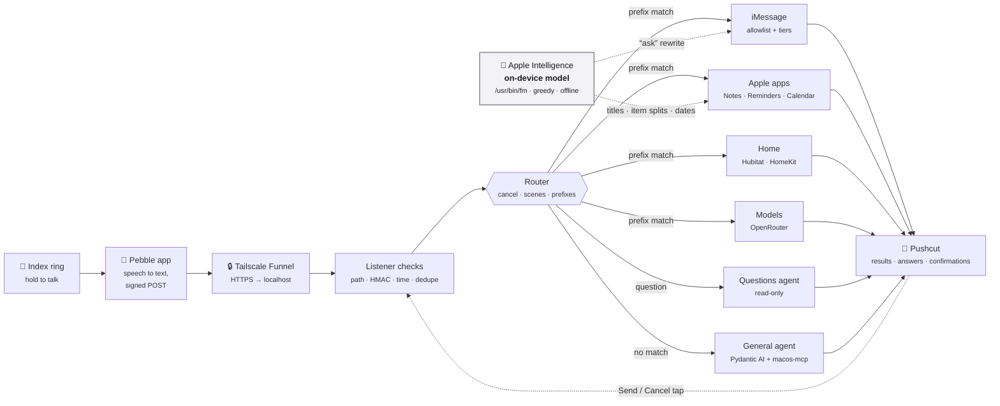

# Ring Router — Build Plan

A small listener on the Mac mini takes voice transcripts from the **Pebble Index 01** ring and routes
each one to the right action: iMessage, Notes, Reminders, Calendar, home devices, or an outside AI
model. Answers and confirmations come back as **Pushcut** notifications.

> **Status (Nov 2026):** phases 1–2 skeleton built and tested in dry run; see the
> [README](../README.md#status) for what's real vs stubbed. This plan records the decisions.

**Contents:** [Goals](#goals) · [How the Index sends data](#how-the-pebble-index-sends-data) ·
[Architecture](#architecture) · [Routing & safety](#routing-and-recipient-safety) ·
[Route catalog](#route-catalog) · [Additional routes](#additional-routes) ·
[Questions agent](#questions-agent) · [Timers](#timers-and-alarms-refused) ·
[On-device model](#on-device-apple-model) · [Home](#home-automation) ·
[External models](#external-models) · [Responses](#responses-and-confirmations) ·
[Security](#security-and-permissions) · [Phases](#build-phases) · [Open questions](#open-questions-and-risks) ·
[Sources](#sources)

---

## Goals

- Common commands ("tell Terri I'm on my way") run with **no cloud LLM** in the path: fast, cheap, predictable.
- Anything that doesn't match a prefix goes to a **general agent** with the macOS tools.
- Messages only go to **allowlisted** people and chats; nothing risky happens without a confirmation.
- Both home automation paths, **Hubitat** and **HomeKit**, can be tested side by side.

**Not in scope:** email (the macos-mcp mail tools are left out; Gmail if ever needed), and anything
sent back to the ring itself, which has no screen or speaker.

---

## How the Pebble Index sends data

The phone app transcribes, then POSTs to **one** custom webhook. Nothing comes back to the ring.
Details come from Pebble's docs and community receivers; phase 0 confirms them against real traffic.

| Aspect | What we know |
| --- | --- |
| Where transcription runs | On the phone. Local mode is a one-time ~670 MB download; cloud mode uses Wispr Flow; each can fall back to the other. |
| Webhook slots | One, under the Index tab in the app. |
| Ring button routing | "Webhook only", or a built-in action plus "Also send to webhook". **Webhook only** avoids duplicate notes and reminders. |
| What to send | "Transcription only". "Recording only" sends no text. |
| Format | `multipart/form-data`, protocol v1 |
| Fields | `transcription`, `recordedAt` (Unix ms), `audio` (m4a, ignored), `client`, `test` |
| Headers | `X-Index-Webhook-Version` (`1`), `X-Index-Timestamp` (Unix s), `X-Index-Delivery` (recording ID, reused on retries), `X-Index-Trigger` (`single-click-hold`, `double-click-hold`, `test-event`), `X-Index-Test`, `X-Index-Signature` |
| Signing | HMAC-SHA256 hex over `v1\n{timestamp}\n{delivery}\n{trigger}\n{1\|0}\n` + raw body. Secret pasted into the app's "Sign requests" setting. |
| Retries | A **503** is retried every minute, up to 10×. 200, 4xx and 422 are not retried automatically. |
| Reply to user | None. The app shows only the status code in Recent runs. |

### Request handling

Adapted from [th3walkingdud3/peeble-ring-router](https://github.com/th3walkingdud3/peeble-ring-router):

1. Secret URL path (`/hook/<token>`); a wrong path gets **404**.
2. Constant-time HMAC check and a ±5-minute timestamp window; failure gets **401**.
3. Test events get 200 and run nothing; other triggers are ignored.
4. De-duplicate by `X-Index-Delivery` in SQLite; repeats get 200 and don't run again.
5. Parse the multipart body; drop the audio part.
6. A send that times out is marked `unknown`, gets **422**, and is **never re-sent automatically**.
7. Global and per-route dry run, plus a simulator that sends signed fake requests.

**What we add:** slow routes (models, agents) store the job, reply `200 accepted` immediately, and
finish in the background; the result arrives by Pushcut.

---

## Architecture

One Python service on the Mac mini. It listens on localhost only; Tailscale Funnel brings requests in;
launchd keeps it running, like `calsync`.

Fast fixed routes reply to the Pebble app with their real result; slow routes reply "accepted".
A confirm tap in Pushcut calls back into the listener to run the pending action.

---

## Routing and recipient safety

The router is a pure function of (transcript, config). Order:

1. **Cancel phrase** at the end → nothing runs.
2. **Scene**: exact whole-transcript match only.
3. **Fixed prefix routes**, most specific first.
4. **Refusals** (timers, alarms).
5. **Looks like a question** → read-only questions agent.
6. **Anything else** → general agent.

### Cancel detection

If a transcript ends with a cancel phrase, nothing runs; Pushcut says "Cancelled, nothing done".

| Strength | Example phrases | Cancels when |
| --- | --- | --- |
| Strong | "cancel cancel", "cancel that", "scrap that", "never mind", "ignore me", "abort" | They end the transcript, or are all of it |
| Weak | "forget that", "don't do that", "stop", "cancel" | They end the transcript **and** follow a sentence break |

"Tell Terri I'll be late. Scrap that." is cancelled; "Tell Terri to forget that" sends.

**Later:** a separate "cancel" recording cancels the most recent unfinished action, and mid-sentence
corrections ("…scrap that, tell Terri I'm on my way") run only the part after the cancel phrase.

### Taking back a sent message (later)

| Option | How | Trade-off |
| --- | --- | --- |
| **Send delay** (build first) | Each message waits a few seconds; a "cancel" in that window stops it | Reliable for SMS and any device; every message arrives slightly later (per-recipient, can be 0) |
| iMessage **Undo Send** (experiment) | UI-scripts Messages' own Undo Send | Messages' AppleScript only has `send`, so it's fragile; needs Accessibility and a logged-in session; 2-minute window; old OS versions still see the original |

### Recipient tiers

| Tier | Example | Action |
| --- | --- | --- |
| 1. Allowlisted, strong match | "tell terri…", "tell terry…" | Send, then a receipt notification |
| 2. Allowlisted, weak match | "tell sherry…" | Pushcut confirmation: **Send / Cancel** |
| 3. Not allowlisted | "tell harry…" | Never sent: "Didn't recognize 'harry', nothing sent." |
| 3b. *(later)* LLM guess | "tell harry…" | Suggests who you meant from message recency; you confirm |

Names match by spelling **and** sound. "Hey X" / "X, …" is direct speech (sent as spoken); only
"ask X…" is rewritten into a direct question. "Tell X to grab milk" sends "Grab milk".

---

## Route catalog

| # | You say | Handler | LLM | Backend |
| --- | --- | --- | --- | --- |
| 1 | "Ask Terri when she'll be home" | Rewrite into a direct question, iMessage | on-device | macos-mcp `messages_chat` |
| 2 | "Instinct…", "hey / ask / tell Instinct…" | iMessage ("ask" rewritten) | on-device for "ask" | macos-mcp `messages_chat` |
| 3 | "Tell Terri I'm on my way" | iMessage, words as spoken | none | macos-mcp `messages_chat` |
| 4 | "Tell the guys let's hang out tomorrow" | Group chat by chat ID | none | macos-mcp `messages_chat` (`chatId`) |
| 5 | "Make a note: …" | New note, titled by on-device summary | on-device | macos-mcp `notes_items` |
| 6a | "Remind me at 5 to call the vet" | Extract title + due time | on-device | macos-mcp `reminders_tasks` |
| 6b | "Remind me when I get home to…" | Location trigger | on-device | Custom Swift EventKit helper (macos-mcp can't) |
| 7 | "Add dentist Tuesday at 3 to my calendar" | Extract title, time, calendar | on-device | macos-mcp `calendar_events` |
| 8 | "Turn on the living room light" | Device alias + action | cheap | Hubitat Maker API or HomeMCPBridge |
| 9 | "Ask ChatGPT / Claude / DeepSeek / Qwen …" | Prefix picks the model | yes | OpenRouter |
| — | anything else | General agent | yes | Pydantic AI on OpenRouter + macos-mcp |

Date extraction always includes today's date and time zone. The macos-mcp mail tools are never exposed.

---

## Additional routes

| Route | You say | Output |
| --- | --- | --- |
| **Claude Code per host** | "Ask Claude Code on the RackNerd VPS why the websites are down" | Headless `claude -p` locally or over SSH; Pushcut summary |
| **Shopping list** | "Add milk and eggs to my shopping list" | One reminder per item in the Reminders list "Shopping list" |
| **Remember** | "Remember I parked on level 3, row G" | A new note in the "Remember" folder |
| **Scenes** | "Goodnight" (the entire transcript) | Fixed device actions |
| **Research** | "Research the best robot vacuum under $500" / "Research with DeepSeek…" | A note in the "Research" folder; Pushcut just says it's ready |

- **Claude Code:** hosts and spoken names are in config; unknown hosts are refused; default is the
  Mac mini. "Ask" is read-only (reads and allowlisted diagnostics); "tell" always needs a confirmation.
- **Shopping list:** on-device structured output splits items, so "mac and cheese" stays one item.
- **Remember:** one note each, because macos-mcp caps note bodies at 2,000 characters.
- **Research:** like "ask ChatGPT" but the output is a note; written via AppleScript to avoid the 2,000-character cap.

---

## Questions agent

Questions about your own data go to a **read-only** agent: the same Pydantic AI setup as the general
agent, with only read tools. Unclear cases go here first because it's the safe side; if an action is
needed it replies with the command to say.

| Source | Tool | Example | Access needed |
| --- | --- | --- | --- |
| Calendar | `calendar_events` read | "What's on my calendar Thursday?" | Calendars (covers Google via `calsync`) |
| Reminders | `reminders_tasks` read | "What's on my shopping list?" | Reminders |
| Notes | `notes_items` search | "Where did I park?" | Automation (Notes) |
| Contacts | `contacts_people` search | "What's Instinct's address?" | Contacts |
| Messages | `messages_chat` read | "Did Terri text me?" | **Full Disk Access** |
| Home status | Hubitat / HomeMCPBridge | "Is the garage closed?" | Hubitat token, HomeKit |

**Decisions to make**

- [ ] Full Disk Access is granted per program, so use a small wrapper app or leave Messages out.
- [ ] Private text goes to the model: use OpenRouter's no-training/no-retention provider settings; consider on-device only for Messages.
- [ ] Cap how much is read per question (e.g. 7 days of messages, 50 notes).
- [ ] Gmail and Google Drive: in or out?

**General agent and Instinct:** the general agent makes calendar changes itself with macos-mcp. It
can't message anyone. If it can't finish a request (e.g. it needs someone else's availability) it says
so and suggests a command, such as "ask Instinct to find a time for you and Terri".

---

## Timers and alarms: refused

The Mac can't set the iPhone's Clock timers or alarms, and substitutes aren't worth having.

- "Set a timer", "timer for", "wake me at", "set an alarm" hit a **refusal** before any agent; Pushcut
  says "Timers and alarms aren't supported from the ring".
- The general agent has no scheduling tool and is told to decline rather than make a reminder instead.
- *Optional experiment:* Focus mode via a Mac Shortcut that syncs to the iPhone ("Share across devices").

---

## On-device Apple model

macOS 27 ships Apple's on-device model as `/usr/bin/fm`: free, offline, ~0.35 s per call. It runs in
**greedy** mode, so the same input always gives the same output (no time cost). It handles "ask"
rewrites, note titles, shopping-item splits, and reminder/event extraction.

| You say | Sent |
| --- | --- |
| ask Terri when she'll be home | "When will you be home?" |
| ask the guys if they want to get beers Friday | "Do you want to get beers Friday?" |
| ask Instinct whether the report is done and what time we're meeting | "Is the report done and when are we meeting?" |

**Lessons:** strip the prefix before calling the model; send only recipient + remainder; strip a
leading recipient name the model sometimes adds.

**Fall back to your exact words when the rewrite** comes back empty, is more than about twice as long,
or talks about the recipient by name. The receipt always shows the exact text sent.

All model instructions live in [`prompts.toml`](../prompts.toml).

---

## Home automation

One device alias table, two backends:

| Backend | Covers | How | Strengths | Limits |
| --- | --- | --- | --- | --- |
| **Hubitat Maker API** | Z-Wave devices on the hub | Local HTTP, no MCP | Direct, predictable | Hubitat devices only |
| **[HomeMCPBridge](https://github.com/coalsi/HomeMCPBridge)** | Everything in HomeKit | MCP over stdio | Sees every device; locks, garage | Thermostats read-only; young project |

- Each alias names a device and preferred backend; `force_backend` A/B-tests the two paths.
- A cheap model only resolves alias + action; it never controls devices freely.

| Action | Behavior |
| --- | --- |
| Lights, fans, switches, "lock" | Run immediately, then notify |
| Actions in `[home] confirm_actions` | Need a Pushcut tap first. **Empty by default**: the ring only listens while you hold the button, so unlock and garage-open run as spoken |
| Not recognized | Nothing happens; you're told what was heard |

---

## External models

Every "ask a model" request goes through **OpenRouter**, paid per token (a fraction of a cent per
question), with context we keep ourselves.

| Prefix | Family | Note |
| --- | --- | --- |
| ask/tell chatgpt, chat | OpenAI | model ID in config |
| ask/tell claude | Anthropic | model ID in config |
| ask/tell deepseek | DeepSeek | looser on some topics; own blind spots (Chinese politics) |
| ask/tell qwen | Qwen | model ID in config |

- Your words are sent **verbatim** with a note that they're a speech transcript (no rewrite step).
- **Why not your ChatGPT/Claude subscriptions:** there's no API to ChatGPT memory; Codex and `claude -p`
  don't carry consumer memory; headless billing is unclear.
- **Context we build:** `profile.md` (facts about you), a ~10-minute follow-up window, OpenRouter web search, and a log.
- **General agent:** open source, [Pydantic AI](https://ai.pydantic.dev/) on OpenRouter. Starts with no
  tools and gets only the listed macOS tools. Not the Claude Agent SDK for now (Claude-only, separate CLI
  process, ships shell/file tools); revisit if tasks grow long and multi-step.

---

## Responses and confirmations

| Event | Notification | Buttons |
| --- | --- | --- |
| Message sent | "Sent to Terri: 'When will you be home?'" | — |
| Weak recipient match | "Send to Terri: '…'?" | Send / Cancel |
| Unknown recipient | "Didn't recognize 'harry', nothing sent" | — |
| Confirm-first action (if configured) | "Unlock front door?" | Unlock / Cancel |
| Model answer | Short answer | Open full answer |
| Note / reminder / event | "Note created: Grocery ideas" | — |
| Error | What failed and what was heard | — |

Pending actions get a one-time ID that expires in 5 minutes. Expired or cancelled actions never run.

---

## Security and permissions

Anyone who could fake this webhook could text your contacts or unlock your door.

- Listener binds to **localhost** only; the tunnel is the only way in.
- Checks in order: secret path (404) → HMAC (401) → timestamp ±5 min (401) → dedupe.
- Pushcut callbacks use one-time tokens; refusals log the reason but return no detail.
- **Secrets** live in a git-ignored `.env` (mode 600) and are never logged. Real recipients and chat IDs
  live in the git-ignored `config.toml`.

| Permission | Needed for | Phase |
| --- | --- | --- |
| Automation (Messages, Notes) | Sending iMessages, creating notes | 2 |
| Reminders, Calendars | macos-mcp EventKit tools, location helper | 4 |
| HomeKit | HomeMCPBridge | 5 |
| Full Disk Access | Reading Messages (questions agent, tier 3b) | later, optional |

---

## Build phases

Every route starts in dry run until you've watched it behave.

| Phase | Scope | Done when |
| --- | --- | --- |
| **0. Capture** | Ring setup, Tailscale Funnel, logging endpoint | Real requests verify; "Webhook only" confirmed |
| **1. Skeleton** ✅ | Checks, store, parser, background jobs, notifier, simulator | Recordings echo back; tests pass |
| **2. Messaging** 🟡 | Router, tiers, on-device rewrite, iMessage send | Cases 1–4 live; weak-match confirm works |
| **3. Models** | OpenRouter routes, `profile.md`, follow-ups, web search | Answers arrive by Pushcut |
| **4. Apple apps** | Notes, reminders, calendar live; EventKit location helper | Cases 5–7 work incl. "when I get home" |
| **5. Home** | Aliases, Hubitat + HomeMCPBridge, optional confirm-first actions | Case 8 through both backends |
| **6. General agent** | Pydantic AI + macos-mcp (no mail) | Unmatched commands handled or declined |
| **7. Additional routes** | Shopping list & Remember → timer refusal → scenes → questions agent → research → Claude Code per host → Focus (experimental) | Each live in order |

Tier 3b and the gesture mode switch come later, if real use shows they're worth it.

---

## Open questions and risks

- [ ] Tunnel: Tailscale Funnel (leaning) or Cloudflare Tunnel? Tailscale isn't installed yet.
- [ ] Which calendars need spoken names besides "my calendar"? What's the default?
- [ ] Home coordinates and radius for "when I get home".
- [ ] Device list and spoken names.
- [ ] OpenRouter model IDs for ChatGPT, Claude, DeepSeek, Qwen.
- [ ] How long the Pebble app waits for a response.
- [ ] Pushcut action-button payload format on your plan.

| Risk | Mitigation |
| --- | --- |
| Pebble changes the webhook format | Version header check; unknown fields tolerated and logged |
| A misheard name texts the wrong person | Allowlist, tiers, confirmation on weak matches, receipts |
| A timed-out send gets retried and double-texts | `unknown` sends are never re-sent automatically |
| The on-device rewrite changes meaning | Greedy mode, fallback rules, `sends` tests, receipts; "tell" never rewritten |
| HomeMCPBridge is young | Hubitat path for Z-Wave devices |
| macos-mcp changes under opencode's npx cache | The router pins its own `mcp-macos@4.1.0` |

---

## Sources

- [Pebble Index 01 getting started guide](https://help.repebble.com/en/articles/15434751-index-01-getting-started-guide)
- [Pebble Index MCP and webhook notes](https://ndocs.repebble.com/index-mcp-instructions)
- [th3walkingdud3/peeble-ring-router](https://github.com/th3walkingdud3/peeble-ring-router) — reference for request handling
- [xeb/indexd](https://github.com/xeb/indexd) · [parthchandak02/pebble-hermes-bridge](https://github.com/parthchandak02/pebble-hermes-bridge) · [TMTrevisan/pebble-webhook-bridge](https://github.com/TMTrevisan/pebble-webhook-bridge)
- [Index webhook JSON payload issue #475](https://github.com/coredevices/mobileapp/issues/475)
- [krmj22/macos-mcp](https://github.com/krmj22/macos-mcp) (installed as `mcp-macos` 4.1.0)
- [HomeMCPBridge](https://github.com/coalsi/HomeMCPBridge) · [eventkit-rs](https://docs.rs/crate/eventkit-rs/latest)
- [Using Codex with your ChatGPT plan](https://help.openai.com/en/articles/11369540-using-codex-with-your-chatgpt-plan) · [Sign in with ChatGPT](https://flaviocopes.com/sign-in-with-chatgpt/)
